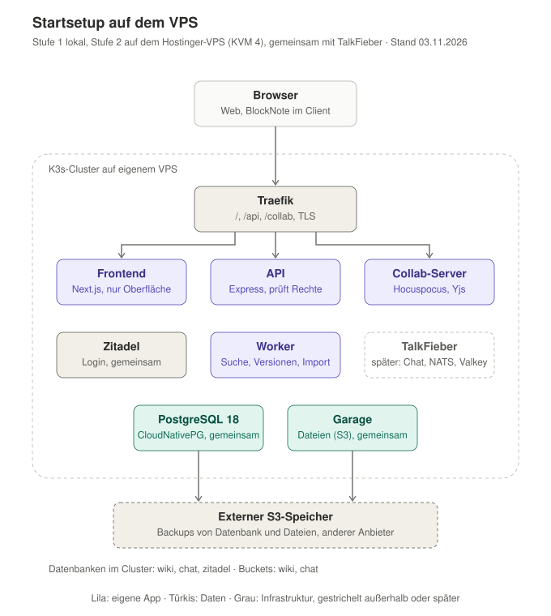

# Europäische Wiki-Plattform – Architektur & MVP

Stand: 5. November 2026 · Peter Forster

Dieses Dokument fasst Ziel, Architektur und Umfang des MVP auf wenigen Seiten zusammen. Die Details stehen in [CONCEPTS.md](CONCEPTS.md) (wie alles funktioniert), [SCHEMA.md](SCHEMA.md) (Datenmodell), [ROADMAP.md](ROADMAP.md) (Meilensteine) und in der `CLAUDE.md` (Entscheidungen). Weicht etwas ab, gelten das Schema und die `CLAUDE.md`.

## Ziel & Leitplanken

Das MVP soll in rund 6 Monaten beweisen, dass ein Team von 10 bis 50 Personen seinen Confluence-Bereich importieren und danach im Alltag ohne Rückfall weiterarbeiten kann, und zwar lieber als vorher mit Confluence. Alles, was diesem Beweis nicht dient, kommt später.

Zielgruppe: Organisationen auf Confluence Data Center, das am 28. März 2029 schreibgeschützt wird, und die nicht in eine US-Cloud wechseln wollen oder dürfen.

**Wettbewerb:** Mit XWiki (Frankreich) gibt es bereits eine europäische Open-Source-Alternative mit Confluence-Migration, Rechten, gemeinsamem Bearbeiten und On-Prem-Betrieb; sie ist auch die Wiki-Komponente von openDesk. Dazu kommt BlueSpice (Deutschland, auf MediaWiki). „Europäisch, Import, Rechte, On-Prem“ allein unterscheidet deshalb nicht. Der Unterschied muss liegen in:

- **Bedienung:** schnell und modern wie Notion, ruhig und vertraut für Confluence-Umsteiger.
- **Einem Import, dem man vertraut:** Probelauf mit klarem Bericht, vorher berechnete Rechte, danach sieht niemand mehr als in Confluence.
- **Verständlichen Rechten:** vier Rollen, eine Regel, „Ansehen als …“ zum Prüfen.
- **Wiki und Chat aus einer Hand** mit TalkFieber (nach dem MVP).

Leitplanken, die jede Technikentscheidung prüfen muss:

- **Bleibt selbst hostbar:** Dieselben Kubernetes-Manifeste laufen in der eigenen Cloud und später beim Kunden. Das Helm-Chart für On-Prem-Kunden kommt nach dem Pilot (Stufe 3, Epic E23).
- **Keine US-Abhängigkeit zur Laufzeit:** kein Pflicht-Dienst von AWS, Google, Auth0, Algolia o. ä.; alles läuft auf eigener oder EU-Infrastruktur.
- **Offene Lizenzen ohne Falle:** jede Bibliothek muss kommerziellen Einsatz in einem Produkt erlauben, das ggf. nicht vollständig offengelegt wird.
- **Daten gehören dem Kunden:** vollständiger Export (Markdown plus BlockNote-JSON plus Anhänge) jederzeit, ohne Support-Ticket. Den Inhalt speichert die Datenbank neben dem Yjs-Zustand auch als BlockNote-JSON, damit Export und ein späterer Editorwechsel nicht an Yjs hängen.
- **Langweilige Technik, wo es geht:** Innovation nur im Editor-Erlebnis, im Import und in der Verständlichkeit der Rechte, nicht in der Infrastruktur.

## Tech-Stack

TypeScript durchgängig: Next.js als Oberfläche, Express als API, BlockNote als Editor, Yjs und Hocuspocus für gemeinsames Bearbeiten, PostgreSQL 18 über CloudNativePG, Zitadel für den Login, Garage für Dateien, alles auf K3s. Bewusst bewährte statt neuester Technik.

| Baustein | Wahl im MVP | Lizenz | Warum |
| --- | --- | --- | --- |
| Editor | [BlockNote](https://github.com/opf/BlockNote) (auf Tiptap/ProseMirror) | MPL-2.0 (Core) | Notion-artige Blöcke, Slash-Menü, Drag & Drop und Yjs-Anbindung fertig; La Suite Docs nutzt ihn ebenfalls |
| Echtzeit | [Yjs](https://github.com/yjs/yjs) + [Hocuspocus](https://github.com/ueberdosis/hocuspocus) | MIT | Bewährter CRDT plus fertiger WebSocket-Server mit Einstiegspunkten für Login und Speichern |
| Frontend | Next.js (App Router) als Standalone-Container | MIT | Bekanntes Werkzeug; reine Oberfläche, alle Daten über die API; Editor als Client-Komponente ohne SSR |
| API | Node.js mit Express 5, Zod für Validierung, Drizzle ORM | MIT | Verbreitet und stabil; Zod ergänzt die Validierung, die Express nicht mitbringt |
| Datenbank | PostgreSQL 18 mit `ltree` und `pg_trgm` über CloudNativePG, gemeinsamer Cluster mit TalkFieber | PostgreSQL / Apache-2.0 | Seitenbaum, Rechte, Inhalt, Versionen, Suche und Jobs in einem System; der Operator übernimmt Backups mit Wiederherstellung auf jeden Zeitpunkt |
| Suche | PostgreSQL-Volltext in eigener Tabelle `page_search` (deutsche Sprachkonfiguration, Titel stärker gewichtet), Trigramm-Index für Titel | – | Vom Worker gepflegt; reicht bis ca. 100.000 Seiten pro Mandant, danach OpenSearch ohne Umbau der App |
| Dateien | Garage (S3-kompatibel) im Cluster, gemeinsam mit TalkFieber | AGPL-3.0 (unverändert genutzt) | Eigener Bucket pro Produkt; Datenbank- und Datei-Backups gehen zu externem EU-S3 (z. B. Hetzner Object Storage) |
| Login | [Zitadel](https://zitadel.com/blog/zitadel-v3-announcement), selbst gehostet; die App spricht nur generisches OIDC | AGPL-3.0 (unverändert genutzt) | Mitgelieferter Login-Dienst, gemeinsam mit TalkFieber; Kunden können stattdessen Entra ID, Keycloak o. ä. anschließen |
| Hintergrundjobs | pg-boss (Queue in PostgreSQL) | MIT | Import, Suchindex, Versionen, Exporte ohne zusätzlichen Dienst |
| Betrieb | K3s mit Traefik-Ingress und cert-manager | Apache-2.0 | Leichtes Kubernetes auf einem VPS; dieselben Manifeste später beim zertifizierten Anbieter und im Helm-Chart |

**Lizenzfalle Editor:** Der Großteil von BlockNote steht unter MPL-2.0 und darf in kommerziellen, auch geschlossenen Produkten genutzt werden ([Quelle](https://socket.dev/npm/package/@blocknote/core/overview/0.50.0)). Die XL-Pakete (u. a. KI, PDF/Word/ODT-Export, mehrspaltige Layouts) stehen unter GPL-3.0 und brauchen sonst eine kommerzielle Lizenz ([Quelle](https://github.com/opf/BlockNote)). Für das MVP: XL-Pakete weglassen, Export selbst bauen, Entscheidung später.

**Regel für Next.js:** Next ist nur die Oberfläche. Keine Geschäftslogik in Server Actions oder Route Handlern, sonst entstehen zwei Backends. WebSockets laufen ohnehin nicht in Next, daher bleibt Hocuspocus ein eigener Dienst.

**Lizenz Zitadel und Garage:** Beide stehen unter AGPL-3.0. Pflichten entstehen nur, wenn man ihren Code ändert ([Quelle Zitadel](https://zitadel.com/blog/apache-to-agpl)). NoteFieber nutzt beide unverändert über Standard-Schnittstellen, der eigene Code bleibt unberührt. Zitadel läuft seit Version 3 nur noch auf PostgreSQL und nutzt deshalb den CloudNativePG-Cluster mit (eigene Datenbank).

## Systemarchitektur

Das MVP besteht aus vier eigenen Prozessen (Next.js-Frontend, Express-API, Collab-Server, Worker) plus PostgreSQL und Garage. Als Login-Dienst läuft Zitadel mit, austauschbar über OIDC.

Der Browser holt Struktur, Rechte und Suche über die API und bearbeitet Text über eine WebSocket-Verbindung zum Collab-Server. Beide schreiben in dieselbe Datenbank, sodass es nur eine Wahrheit gibt. Der Worker pflegt Suchindex, Verlinkungen und Versionen, führt Importe und Exporte aus und verteilt die Ereignisse aus der Outbox. Die Zielarchitektur für den Produktivbetrieb zeigt [architecture_flow.svg](models/architecture/architecture_target.svg).

## Datenmodell

Der Seiteninhalt lebt als Yjs-Dokument; alles, was gesucht, sortiert oder berechtigt wird, steht zusätzlich in normalen Spalten. So bleibt PostgreSQL die Wahrheit für Struktur und Rechte, Yjs nur für den Text. Jede Tabelle und Funktion beschreibt [SCHEMA.md](SCHEMA.md), das Schema liegt in `database/scripts/schema/`.

| Bereich | Tabellen | Inhalt |
| --- | --- | --- |
| Mandanten und Personen | `tenants`, `users`, `workspaces`, `workspace_members`, `groups`, `group_members`, `invites` | Gleiches Modell wie TalkFieber, gleiche `tenant_id` (eine Zitadel-Organisation) |
| Wiki | `spaces`, `pages` | Bereiche wie in Confluence und der Seitenbaum mit `ltree`-Pfad, Fractional-Index-Position und Papierkorb |
| Inhalt | `page_contents`, `page_versions` | Aktueller Yjs-Zustand mit BlockNote-JSON und Klartext, nummerierte Versionen mit Autoren |
| Abgeleitet | `page_search`, `page_links` | Suchindex und Verlinkungen, vom Worker gepflegt |
| Rechte | `grants` | Rolle für eine Person, eine Gruppe oder „Alle im Workspace“ auf einem Space oder einer Seite mit eigenen Rechten |
| Zusammenarbeit | `comments`, `files` | Kommentare an Seite und Textstellen, Anhänge in Garage |
| Import | `imports`, `import_items` | Importläufe und die Zuordnung Confluence-Seite → neue Seite |
| Querschnitt | `outbox`, `audit_log` | Ereignisse für Worker und später TalkFieber, Protokoll |

Was die Datenbank selbst absichert:

- **Row Level Security auf jeder Tabelle:** Mandantentrennung für alle, zusätzlich Leserechte für Anfragen von Personen. Alles, was an einer Seite hängt (Inhalt, Versionen, Suchtreffer, Kommentare, Anhänge, Verlinkungen), ist nur mit ihr sichtbar.
- **Drei Rollen:** `wiki_owner` nur für Migrationen, `wiki_app` für die API, `wiki_worker` für Collab-Server und Worker. Die App verbindet sich nie als Eigentümer.
- **Schreiben über Funktionen:** `wiki_app` schreibt fast nur über Funktionen im Schema `app`, die Rechte und Mandant selbst prüfen und niemanden im Namen anderer handeln lassen.
- **Sperren im Seitenbaum:** Verschieben, Papierkorb und Vererbung laufen pro Space nacheinander, damit keine Zyklen oder veralteten Pfade entstehen.

Die Tests liegen in `database/scripts/schema_test/`: 44 Funktionstests und ein Test für gleichzeitige Sitzungen.

## Echtzeit-Kollaboration

Jede geöffnete Seite ist ein Yjs-Dokument, das Hocuspocus im Speicher hält und gebündelt in PostgreSQL speichert. Konflikte gibt es dadurch nicht; die eigentliche Arbeit liegt in Login, Rechten, Speichern und Versionen.

Ablauf einer Sitzung:

1. Der Browser holt bei der API ein kurzlebiges Token und öffnet eine WebSocket-Verbindung zum Collab-Server, Dokument `page:<id>`.
2. `onAuthenticate` prüft das Token und fragt die API nach der Rolle. Lesende und Kommentierende bekommen eine schreibgeschützte Verbindung, Bearbeitende eine schreibende.
3. `onLoadDocument` lädt den Yjs-Zustand. Bei einer neuen, leeren Seite schreibt der Collab-Server zuerst den Titel aus der Datenbank ins Dokument, sonst würde das erste Speichern ihn leeren.
4. Änderungen laufen als kleine Yjs-Updates zwischen allen Browsern; Cursor und Anwesenheit über Yjs Awareness, nie gespeichert.
5. `onStoreDocument` (entprellt, etwa alle 2 s) ruft `app.store_content` auf: Yjs-Zustand, BlockNote-JSON, Klartext, Titel und Bearbeitende. Das darf nur der Collab-Server (`wiki_worker`).

**Titel:** Der Titel lebt im Yjs-Dokument und wird nur im Editor geändert; die Datenbank hält eine Kopie für Baum und Suche.

**Rechte während der Sitzung:** Ändern sich Rechte, Vererbung, Mitgliedschaft oder der Archiv-Status eines Spaces, trennt der Collab-Server die betroffenen Verbindungen. Sie melden sich neu an und bekommen die neue Rolle oder keinen Zugang mehr.

**Versionen:** Der Worker legt eine Version an, wenn eine Seite 10 Minuten unberührt war; Bearbeitende können jederzeit „Version speichern“ klicken. Wiederherstellen wendet den alten Stand als neue Änderung an und legt eine neue Version an, statt zu überschreiben. So bleibt die Historie linear.

**Skalierung:** Im MVP genau eine Hocuspocus-Instanz (Hunderte gleichzeitige Dokumente). Für mehrere Instanzen später entweder Verteilung nach Dokument-ID oder die Redis-Erweiterung von Hocuspocus mit Valkey.

**Offline:** Yjs puffert kurz im Browser. Fürs MVP nur „kurz Netz weg überleben“, kein echter Offline-Modus, der bringt Rechte- und Konfliktfragen, die jetzt nicht nötig sind.

## Berechtigungen & Sicherheit

Rechte werden am Space vergeben und an Seiten vererbt; eine Seite kann die Vererbung kappen und bekommt dann eigene Rechte, die auch für ihre Unterseiten gelten. Das ist **bewusst einfacher als Confluence**: Dort wirken Anzeige-Einschränkungen als Schnittmenge über alle Elternseiten, Bearbeitungs-Einschränkungen nur auf der einen Seite. Der Import rechnet die Confluence-Rechte deshalb in das eigene Modell um, sodass danach niemand mehr sieht als vorher.

| Rolle | Darf |
| --- | --- |
| Viewer (Lesen) | lesen, suchen, exportieren, was sichtbar ist |
| Commenter (Kommentieren) | zusätzlich kommentieren |
| Editor (Bearbeiten) | zusätzlich bearbeiten, Seiten anlegen, verschieben, in den Papierkorb legen, Versionen speichern und wiederherstellen |
| Admin | zusätzlich Rechte und Vererbung ändern, Space-Einstellungen, archivieren, fremde Kommentare löschen, importieren |

Endgültig gelöscht wird nur aus dem Papierkorb, durch den Worker nach 30 Tagen.

**Auflösung einer Berechtigung:** Die Person muss aktives Mitglied des Workspaces sein. Dann von der Seite den Pfad hinauf bis zur ersten Seite mit eigenen Rechten (oder bis zum Space), dort die Grants für die Person, ihre Gruppen und „Alle im Workspace“ (nicht für Gäste) sammeln, die höchste Rolle gewinnt. In archivierten Spaces höchstens Lesen. Gerechnet wird bei jeder Abfrage in der Datenbank, ohne Cache. Erst bei großen Seitenbäumen kommt eine vom Worker gepflegte Tabelle mit effektiven Rechten dazu.

**Die eine Regel, die nie gebrochen wird:** Seitenbaum, Suche, Link-Vorschau, Kommentare, Anhänge, Export, Benachrichtigungen und Import gehen alle durch dieselbe Rechte-Funktion. Die meisten Datenlecks in Wikis entstehen über Nebenwege, nicht über die Seite selbst.

Weitere Regeln:

- Jeder Space und jede Seite mit eigenen Rechten behält mindestens einen **wirksamen** Admin (aktive Person oder Gruppe mit aktivem Mitglied). „Alle im Workspace“ kann nie Admin sein.
- Wer eine Seite **aus einem Bereich mit eigenen Rechten herausschiebt**, muss dort Admin sein. Sonst könnte ein Bearbeiter eine vertrauliche Seite für den ganzen Space freigeben.
- **Organisations-Admins** sehen Inhalte nicht automatisch. Sie können aber auf jedem Space Rechte setzen, wenn kein Admin mehr erreichbar ist; das steht im Audit-Log.
- **„Ansehen als …“:** Space-Admins sehen eine Seite, den Baum oder die Suche so, wie eine bestimmte Person sie sieht. Das ist das Prüfwerkzeug nach dem Import. In der Datenbank liefert `app.view_as` dafür Struktur und Rolle der Person, nur für Admins, ohne Bereiche, die die handelnde Person nicht selbst verwaltet, und mit Eintrag im Audit-Log.

Sicherheit im MVP:

- Login nur über OIDC (Zitadel mitgeliefert, alternativ Entra ID, Keycloak, Okta …); Gruppen aus dem Token übernehmen. Personen sind pro Mandant eindeutig, dieselbe Person kann in mehreren Mandanten ein Konto haben.
- Audit-Log für Rechte, Vererbung, Mitgliedschaften, Verschieben, Papierkorb, Archivieren, Import, Export und das Löschen fremder Kommentare, unveränderbar, lesbar nur für Organisations-Admins. Anmeldungen protokolliert Zitadel.
- Verschlüsselung: TLS überall, Datenträger- und Backup-Verschlüsselung; keine Ende-zu-Ende-Verschlüsselung (bricht Suche, Import und Export).
- Anhänge: Hochladen nur mit Bearbeitungsrecht, Virenscan vor der Freigabe, Ausliefern nur über kurzlebige, signierte URLs; HTML und SVG nur als Download.
- Später: SCIM für die Benutzerverwaltung, Aufbewahrungsrichtlinien, IP-Beschränkungen.

## MVP-Umfang

Das MVP ist ein Wiki, kein Notion: Seiten im Baum, gemeinsam bearbeitet, gut durchsuchbar, aus Confluence importierbar, mit Rechten, denen man vertraut. Datenbanken, Boards und KI kommen erst, wenn echte Nutzer danach fragen.

**Drin:**

- [ ] Workspaces, Spaces mit Startseite, Seitenbaum mit Drag & Drop, Archivieren
- [ ] Block-Editor: Überschriften, Listen, Aufgaben, Tabellen, Code, Bilder, Callouts, Seitenlinks
- [ ] Echtzeit-Bearbeitung mit Cursorn und Anwesenheit
- [ ] Kommentare an Textstellen und an der Seite, Antworten, erledigt markieren
- [ ] Versionshistorie mit Vergleichen und Wiederherstellen
- [ ] Papierkorb für ganze Teilbäume
- [ ] Rechte auf Space- und Seitenebene mit Vererbung, Gruppen aus dem Login-Dienst, „Alle im Workspace“
- [ ] „Ansehen als …“ für Space-Admins
- [ ] Dateien und Bilder mit Virenscan und Vorschau
- [ ] Volltextsuche über Titel und Inhalt, Schnellsuche nach Titeln
- [ ] Login über OIDC, Einladungen per Link
- [ ] Confluence-Import (Space-Export als HTML/XML): Hierarchie, Inhalte, Anhänge, Rechte, häufige Makros, Rest als sichtbarer Platzhalter; Probelauf mit Bericht, rückgängig machbar
- [ ] Export: Markdown plus BlockNote-JSON plus Anhänge als ZIP, nur mit dem, was die Person lesen darf
- [ ] Audit-Log
- [ ] Installation per Manifesten auf K3s

**Bewusst nicht drin:**

- Datenbanken und Tabellen-Ansichten à la Notion
- KI-Funktionen
- Mobile Apps (responsives Web reicht)
- Echter Offline-Modus
- Entwurfs- und Freigabemodus (Änderungen sind sofort sichtbar)
- Öffentliche Seiten und Gastzugänge in der Oberfläche (das Datenmodell kann Gäste schon)
- Verschieben zwischen Spaces
- Integrationen außer einem einfachen Webhook, Jira-Anbindung (wichtig, aber eigenes Projekt)
- Helm-Chart für On-Prem-Kunden (Stufe 3)
- Weitere Ideen wie Verantwortliche mit Prüfdatum, Lesebestätigung oder Entscheidungs-Block: direkt nach dem Pilot

## Fahrplan

Sechs Meilensteine in rund 26 Wochen für eine Person in Vollzeit, wie in der [ROADMAP](ROADMAP.md). Davor liegt die Vorbereitung (Stufe 0): Gespräche mit Confluence-Data-Center-Kunden, 2–3 echte Exporte besorgen, XWiki und BlueSpice mit einem echten Export ausprobieren.

| Meilenstein | Wochen | Inhalt | Gate |
| --- | --- | --- | --- |
| M0 Fundament | 1–4 | Repository, CI, lokale Umgebung, Schema als erste Migration, Login über Zitadel, Spaces und Seitenbaum per API | Login über Zitadel, Seite anlegen, im Baum verschieben |
| M1 Editor & Echtzeit | 5–8 | Next.js-Gerüst, BlockNote, Hocuspocus mit Speichern in PostgreSQL, erster Lasttest | Zwei Personen bearbeiten gleichzeitig, nichts geht verloren |
| M2 Wiki-Grundfunktionen | 9–11 | Spaces mit Startseite, Drag & Drop, Blöcke, Versionen, Papierkorb, Web-Client nach Prototyp | Eigene Projektdokumentation läuft im Wiki |
| M3 Rechte, Suche, Kommentare | 12–15 | Rollen und Vererbung, „Ansehen als“, Kommentare, Dateien, Suche, Export, Audit-Log | Kein Lesepfad zeigt Seiten ohne Leserecht, durch Tests abgesichert |
| M4 Confluence-Import | 16–21 | Export einlesen, Rechte übersetzen, Makros, Probelauf mit Bericht, Links umschreiben | Ein echter Pilot-Space ist importiert und vom Kunden abgenommen |
| M5 Pilot | 22–26 | VPS, Backups mit getesteter Wiederherstellung, Überwachung, 2–3 Pilotkunden | Ein Pilot arbeitet vier Wochen ohne Confluence und lieber als mit Confluence |

Rechte kommen vor dem Import, weil der Import Confluence-Rechte abbilden muss. Erst wenn ein Gate erreicht ist, beginnt der nächste Meilenstein; bei Verzug wird Umfang gestrichen, nicht das Gate. Nebenbei (10–15 Stunden pro Woche) ist es eher das Dreifache. Dann den Umfang von M2 und M3 kürzen, nie den Import.

## Deployment & Betrieb

Start auf einem einzelnen Hostinger-VPS (KVM 4: 4 vCPU, 16 GB RAM, EU-Standort) mit K3s, ausschließlich für Wiki und TalkFieber. Das Wiki allein braucht etwa 3–4 GB, mit TalkFieber etwa 5–8 GB. Dieselben Manifeste werden später das Helm-Chart für Kunden-Installationen und laufen beim zertifizierten EU-Anbieter, so gibt es nur einen Codepfad.

**Ein Cluster für beide Produkte:** Wiki und TalkFieber teilen sich CloudNativePG (getrennte Datenbanken `wiki`, `chat`, `zitadel`), Zitadel, Garage (getrennte Buckets) und cert-manager. NATS JetStream und Valkey kommen mit TalkFieber dazu.

Aufbau in dieser Reihenfolge:

1. **K3s installieren und absichern:** nach außen nur Port 22 (SSH mit Schlüssel), 80 und 443; die Kubernetes-API nicht öffentlich.
2. **cert-manager** mit Let's-Encrypt-Issuer; Traefik (in K3s enthalten) übernimmt Ingress und WebSockets.
3. **CloudNativePG-Operator**, dann ein PostgreSQL-Cluster mit einer Instanz. Backups und WAL-Archiv laufend zu externem EU-S3.
4. **Zitadel** per Helm-Chart auf eigener Subdomain, angebunden an den CloudNativePG-Cluster.
5. **Garage** für Anhänge, Sicherung zu externem EU-S3.
6. **Migrationen** als eigener Kubernetes-Job mit den Zugangsdaten von `wiki_owner`, vor jedem Ausrollen.
7. **App als vier Deployments:** `web` (Next.js standalone), `api` (Express), `collab` (Hocuspocus, genau eine Replik, Update-Strategie Recreate) und `worker`. Ein Ingress verteilt `/`, `/api` und `/collab`.

Betrieb:

- **Entwicklung lokal:** PostgreSQL 18 im Docker-Container ([LOCAL_SETUP.md](LOCAL_SETUP.md)), später mit Zitadel und Garage per Docker Compose; die Apps direkt mit Node. Der VPS ist die Staging- und Pilot-Umgebung (Namespaces `staging` und `pilot`).
- **Ausliefern:** Container-Images per CI bauen und in eine Registry pushen; anfangs `kubectl apply` mit Kustomize, GitOps (Argo CD oder Flux) erst ab mehreren Umgebungen.
- **Secrets:** Kubernetes-Secrets, verschlüsselt im Repository mit SOPS oder als Sealed Secrets.
- **Rollen:** Die API verbindet sich als Login-Rolle in `wiki_app`, Collab-Server und Worker als Login-Rollen in `wiki_worker`, nie als Eigentümer.
- **Backups:** CloudNativePG sichert laufend nach S3 mit Wiederherstellung auf jeden Zeitpunkt; der Bucket ist versioniert. Wiederherstellung einmal pro Quartal tatsächlich üben.
- **Updates:** Migrationen sind eine Version rückwärtskompatibel, damit Updates ohne Ausfall gehen und On-Prem-Kunden später verspätet aktualisieren können.
- **Beobachtbarkeit:** OpenTelemetry für Traces und Metriken, strukturierte Logs; Alarm bei Ausfall, vollem Speicher, fehlgeschlagenem Backup und zu großen Yjs-Dokumenten; keine Telemetrie nach Hause ohne Zustimmung.
- **Grenze:** Ein Knoten heißt keine Hochverfügbarkeit, jedes K3s- oder OS-Update kostet ein paar Minuten Ausfall. Für Entwicklung und Piloten in Ordnung, vor dem ersten zahlenden Geschäftskunden folgt der Umzug zu einem zertifizierten EU-Anbieter (Hetzner, STACKIT oder IONOS).

Für die Vermarktung später relevant: ein Hosting-Partner mit ISO 27001 bzw. BSI-C5-Testat und ein Auftragsverarbeitungsvertrag nach DSGVO als Standard-Download.

## Zusammenspiel mit TalkFieber

Wiki und TalkFieber werden zwei Produkte auf einer gemeinsamen Plattform: ein Login, ein Mandantenmodell, ein Cluster, eine Sprache (TypeScript). Das Wiki kommt zuerst und legt diese Plattform an; TalkFieber setzt später darauf auf, statt sie ein zweites Mal zu bauen. Zusammen sind beide auch das stärkere Angebot, denn Teams lässt sich realistisch nur als Teil eines größeren Pakets ersetzen.

| Baustein | Gemeinsam | Pro Produkt getrennt |
| --- | --- | --- |
| Login | Eine Zitadel-Instanz, eine Organisation pro Kunde, Single Sign-on über beide Produkte | Eigene OIDC-Clients und Rollen |
| Mandanten | Gleiche `tenant_id`, gleiche RLS-Konvention (App- und Worker-Rolle), Personen pro Mandant eindeutig | Eigene Datenbank im selben CloudNativePG-Cluster |
| Dateien | Eine Garage-Instanz | Eigener Bucket |
| Flüchtige Daten | Valkey (kommt mit TalkFieber) | Eigenes Schlüssel-Präfix |
| Events | NATS JetStream (kommt mit TalkFieber) | Eigene Subjects, z. B. `t.{tenant}.wiki.*` |
| Oberfläche | Gemeinsames Designsystem und Avatare | Eigene Apps und Domains |

Integrationen nach dem Wiki-MVP, sobald TalkFieber läuft:

- **Wiki-Links im Chat** mit Vorschau, vorher gegen die Wiki-Rechte des Lesers geprüft.
- **Benachrichtigungen aus dem Wiki** (Erwähnung, Kommentar, Seite geändert) als Nachricht in TalkFieber statt per E-Mail.
- **Seite und Topic verknüpfen:** „Über diese Seite sprechen“ öffnet ein Topic, das mit der Seite verbunden bleibt.
- **Topic als Seite sichern:** eine erledigte Diskussion mit einem Klick als Entscheidungsprotokoll ins Wiki übernehmen.
- **Gemeinsame Suche** über Seiten und Nachrichten, wenn beide Produkte stabil sind.

Schon vorbereitet: `tenant_id` überall, `app.create_tenant` übernimmt eine bestehende Mandanten-ID, Zitadel-Organisationen als Mandanten und alle Ereignisse in der Outbox. In TalkFieber sind dafür noch zwei Dinge anzupassen: Personen pro Mandant statt global eindeutig (`tenant_id, idp_subject`) und der VPS „ausschließlich für Wiki und TalkFieber“.

## Risiken & offene Entscheidungen

Das größte Risiko ist nicht die Technik, sondern der Import: Wenn die erste Confluence-Migration hässlich aussieht, ist der Kunde weg. Deshalb hat er einen eigenen Meilenstein vor dem Pilot, und echte Exporte von Pilotkunden sollten schon ab M1 als Testdaten vorliegen.

| Risiko | Gegenmaßnahme |
| --- | --- |
| Confluence-Makros (Jira-Tabellen, Seiteneigenschaften, Plugins) lassen sich nicht abbilden | Die häufigsten Makros aus echten Exporten zählen; Rest als sichtbarer Platzhalter-Block mit Originalinhalt |
| Confluence-Rechte lassen sich nicht sauber umrechnen | An echten Exporten prüfen; „Ansehen als“ zur Kontrolle; im Zweifel enger statt weiter |
| XWiki ist „gut genug“ | Früh vergleichen; Bedienung, Import-Bericht und Rechte sichtbar besser machen; Wiki + Chat als Paket |
| Editor-Abhängigkeit von einem kleinen Projekt | Inhalte zusätzlich als BlockNote-JSON speichern (umgesetzt: `page_contents.content_json`, auch in Versionen); Editor austauschbar halten |
| Rechte-Lecks über Suche, Export oder Nebenwege | Eine zentrale Rechte-Funktion in der Datenbank, Leseregeln auf jeder Tabelle, automatisierte Tests pro Lesepfad |
| Yjs-Dokumente wachsen unbegrenzt | Kompaktierung beim Speichern; Größe pro Seite überwachen, Grenze 50 MB in der Datenbank |
| Einzelkämpfer-Tempo | MVP-Umfang strikt halten; früh 2–3 Pilotkunden mit echtem Confluence-Export suchen; Mitstreiter für Stufe 3 |

Offene Entscheidungen:

- [ ] Lizenzmodell des eigenen Codes: Open Core (AGPL + Enterprise-Lizenz) oder proprietär mit Quelltext für Kunden? Für Wiki und Chat gleich.
- [ ] XL-Pakete von BlockNote nutzen (GPL-3.0 oder kommerzielle Lizenz) oder Export selbst bauen?
- [ ] Wie genau die Confluence-Rechte beim Import umgerechnet werden (an echten Exporten prüfen).
- [ ] Reihenfolge SaaS und On-Prem: Empfehlung SaaS-Pilot zuerst, Helm-Chart in Stufe 3.
- [ ] Ab wann große Kunden eine eigene Zelle bekommen (komplett getrennte Instanz des ganzen Stacks). Mandantenfähig mit RLS ist das Wiki trotzdem von Anfang an.
- [ ] Name und Rechtsform: Für die Souveränitäts-Botschaft zählt ein EU-Sitz ohne US-Mutter; ein gemeinsamer Markenname für Wiki und Chat lohnt sich.

## Quellen

- [Atlassian: Data Center End of Life](https://www.atlassian.com/migration)
- [BlockNote auf GitHub (Lizenz der XL-Pakete)](https://github.com/opf/BlockNote)
- [@blocknote/core auf Socket (MPL-2.0)](https://socket.dev/npm/package/@blocknote/core/overview/0.50.0)
- [Hocuspocus auf GitHub (MIT)](https://github.com/ueberdosis/hocuspocus)
- [La Suite Docs auf AlternativeTo](https://alternativeto.net/software/docs/about)
- [Zitadel: Wechsel zu AGPL 3.0](https://zitadel.com/blog/apache-to-agpl)
- [Zitadel v3: Lizenz und PostgreSQL-only](https://zitadel.com/blog/zitadel-v3-announcement)
- [XWiki: Choose your Confluence Data Center alternative](https://xwiki.com/en/blog/choose-your-confluence-data-center-alternative)
- [XWiki: Realtime WYSIWYG Editor](https://extensions.xwiki.org/xwiki/bin/view/Extension/Realtime%20WYSIWYG%20Editor)
- [BlueSpice: Alternative to Confluence Data Center](https://bluespice.com/alternative-to-confluence-data-center/)
- [openDesk: Komponenten](https://docs.opendesk.eu/operations/introduction)
