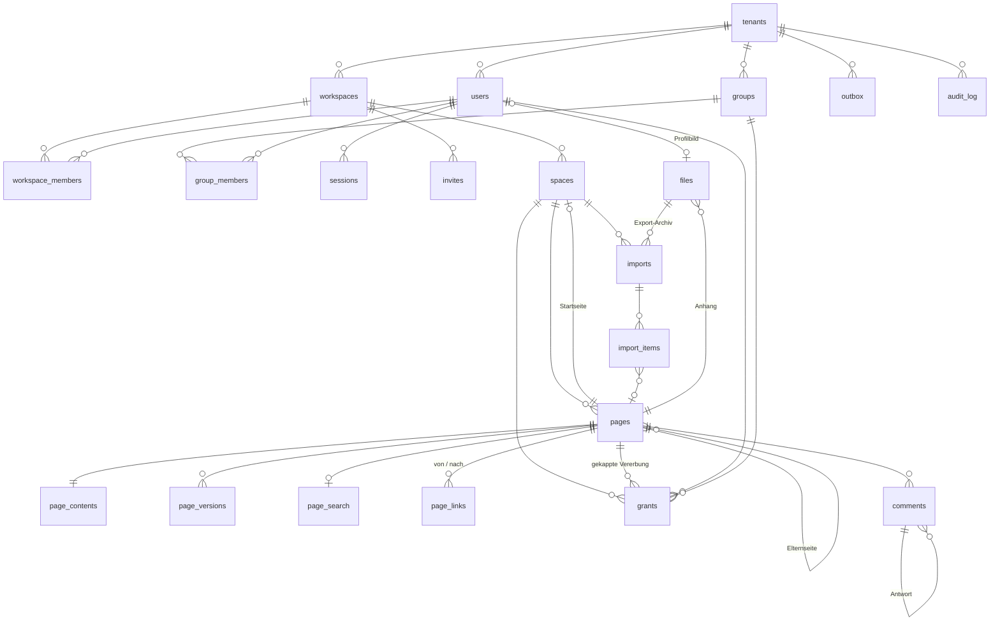

# Datenmodell: Referenz

Dieses Dokument beschreibt jede Tabelle der Datenbank `wiki` und ihre wichtigen Spalten: was sie bedeuten, welche Regeln die Datenbank selbst durchsetzt, wer sie schreibt und wer sie lesen darf. Es ist ein Nachschlagewerk. Warum das Modell so aussieht, erklärt [CONCEPTS.md](CONCEPTS.md) (Abschnitte 11 und 12), die Entscheidungen stehen in der `CLAUDE.md` (Abschnitt 8). Maßgeblich ist immer das Schema in [`database/scripts/schema/`](../database/scripts/schema/). Weicht dieses Dokument davon ab, gilt das Schema, und dieses Dokument wird angepasst.

**Wo steht was?** [`schema.sql`](../database/scripts/schema/schema.sql) ist der Einstieg und bindet die Teile in dieser Reihenfolge in einer Transaktion ein:

| Datei | Inhalt | Hier im Dokument |
|---|---|---|
| [`00_setup.sql`](../database/scripts/schema/00_setup.sql) | Erweiterungen, Schema `app`, Prüfung der Rollen | Abschnitt 9 |
| [`10_tables.sql`](../database/scripts/schema/10_tables.sql) | alle Tabellen und Indexe | Abschnitte 3–8 |
| [`20_functions_base.sql`](../database/scripts/schema/20_functions_base.sql) | Kontext, Rechte auflösen, Prüfungen, Ereignisse, Audit, Sperren | 12.1–12.4 |
| [`30_triggers.sql`](../database/scripts/schema/30_triggers.sql) | Trigger | Abschnitt 13 |
| [`40_functions_tenants.sql`](../database/scripts/schema/40_functions_tenants.sql) | vor dem Login, Mandanten, Personen, Workspaces, Gruppen | 12.5, 12.6 |
| [`50_functions_spaces.sql`](../database/scripts/schema/50_functions_spaces.sql) | Spaces, Rechte, Vererbung | 12.7 |
| [`60_functions_pages.sql`](../database/scripts/schema/60_functions_pages.sql) | Seitenbaum, Papierkorb | 12.8 |
| [`70_functions_content.sql`](../database/scripts/schema/70_functions_content.sql) | Inhalt, Versionen, Verlinkungen | 12.9 |
| [`72_functions_comments.sql`](../database/scripts/schema/72_functions_comments.sql) | Kommentare | 12.10 |
| [`74_functions_import.sql`](../database/scripts/schema/74_functions_import.sql) | Import | 12.11 |
| [`80_rls.sql`](../database/scripts/schema/80_rls.sql) | Row Level Security | Abschnitt 10 |
| [`90_privileges.sql`](../database/scripts/schema/90_privileges.sql) | Rechte an Schemas, Funktionen und Tabellen | Abschnitte 9 und 11 |

Die Rollen und die Datenbank legt [`roles_database.sql`](../database/scripts/roles_database.sql) an. In eine Datenbank kommt das Schema über die Migrationen in [`database/scripts/migrations/`](../database/scripts/migrations/) und [`migrate.sh`](../database/scripts/migrate.sh); `schema/` und die Migrationen ergeben dasselbe Schema (geprüft von `schema_migrations_test.sh`). Ihre Buchführung steht in `migrations.applied` (eigenes Schema, ohne Rechte für die App). Die Tests liegen in [`database/scripts/schema_test/`](../database/scripts/schema_test/).

## Inhalt

1. [Überblick](#1-überblick)
2. [Konventionen für alle Tabellen](#2-konventionen-für-alle-tabellen)
3. [Mandanten und Personen](#3-mandanten-und-personen): `tenants`, `users`, `workspaces`, `workspace_members`, `groups`, `group_members`, `invites`, `sessions`
4. [Spaces und Seiten](#4-spaces-und-seiten): `spaces`, `pages`, `page_contents`, `page_versions`, `page_search`, `page_links`
5. [Rechte](#5-rechte): `grants`
6. [Zusammenarbeit](#6-zusammenarbeit): `comments`, `files`
7. [Import](#7-import): `imports`, `import_items`
8. [Infrastruktur](#8-infrastruktur): `outbox`, `audit_log`
9. [Datenbank, Rollen und Schemas](#9-datenbank-rollen-und-schemas): Locale, Erweiterungen, Rollen, Kontext, `SECURITY DEFINER`
10. [Regeln (Row Level Security)](#10-regeln-row-level-security)
11. [Wer darf was: Tabellenrechte](#11-wer-darf-was-tabellenrechte)
12. [Funktionen](#12-funktionen): jede Funktion einzeln
13. [Trigger](#13-trigger)

---

## 1. Überblick

| Tabelle | Zweck | Schreibt | Lesbar für Personen (`wiki_app`) |
|---|---|---|---|
| `tenants` | Mandant (Kunde), eine Zitadel-Organisation | `create_tenant` | nur der eigene |
| `users` | Personen eines Mandanten | Einladungen, eigenes Profil, Funktionen | Personen aus gemeinsamen Workspaces (selbst Mitglied, nicht nur Gast), sich selbst; Organisations-Admins alle |
| `workspaces` | Bereich innerhalb eines Mandanten | Organisations- und Workspace-Admins | eigene Workspaces; Organisations-Admins alle |
| `workspace_members` | Wer gehört mit welcher Rolle zu einem Workspace | Funktionen | eigene, dazu alle aus Workspaces, in denen man Mitglied ist; Organisations-Admins alle |
| `groups`, `group_members` | Gruppen des Wikis (im Wiki angelegt, aus dem Import, später aus dem Login-Dienst oder per SCIM) | Gruppen-Funktionen (Organisations-Admins), `sync_user_groups` | wer irgendwo Mitglied ist (nicht nur Gast); Organisations-Admins |
| `invites` | Einladungen per Link | Workspace-Admins | Workspace-Admins |
| `sessions` | Sitzungen der API nach dem Login | `create_session`, `end_session`, `set_user_active` | nur die eigenen |
| `spaces` | Confluence-Bereich, Einheit für Rechte und Import | Funktionen | mit Rolle im Space oder einer lesbaren Seite darin |
| `pages` | Seitenbaum | Funktionen | mit Leserecht auf der Seite |
| `page_contents` | Aktueller Inhalt (Yjs) | Collab-Server | mit der Seite |
| `page_versions` | Versionshistorie | Worker, `save_version` | mit der Seite |
| `page_search` | Volltextindex | Worker | mit der Seite |
| `page_links` | Verlinkungen zwischen Seiten | Worker | wenn beide Seiten lesbar sind |
| `grants` | Rechte auf Spaces und Seiten | Funktionen | wer das Objekt lesen darf |
| `comments` | Kommentare | Funktionen | mit der Seite |
| `files` | Anhänge, Profilbilder, Import-Archive | Upload, Worker | an lesbaren Seiten, eigene, Profilbilder |
| `imports`, `import_items` | Confluence-Importläufe | `start_import`, Worker | eigene oder als Space-Admin |
| `outbox` | Ereignisse für Worker und später TalkFieber | Funktionen | nur Worker |
| `audit_log` | Wer hat was getan | Funktionen | nur Organisations-Admins |



## 2. Konventionen für alle Tabellen

- **IDs** sind UUIDv7 (`uuidv7()`, in PostgreSQL 18 eingebaut). Sie sind zeitlich sortierbar; die Outbox wird nach `id` abgearbeitet. Bei Tabellen mit Leseregeln erzeugt die Funktion die ID vorher, statt `INSERT … RETURNING` zu nutzen (die neue Zeile ist für die Person oft noch nicht lesbar).
- **`tenant_id`** steht auf jeder Tabelle (außer `tenants` selbst) und ist dieselbe UUID wie in TalkFieber. Jede Tabelle hat die Regel `tenant_isolation`: Sichtbar und schreibbar ist nur, was zu `app.tenant_id` passt.
- **Zusammengesetzte Fremdschlüssel** wie `(page_id, tenant_id) → pages (id, tenant_id)` verhindern Verweise über Mandanten hinweg, auch für Rollen, die RLS umgehen. Nach demselben Muster erzwingt `(parent_id, space_id)`, dass Elternseiten im selben Space liegen.
- **Text** ist `text` mit `CHECK`-Grenzen statt `varchar(n)`. Die Grenzen stehen bei den Spalten.
- **Zeitstempel** sind `timestamptz`. Statt zu löschen markieren Spalten den Zustand: `deleted_at` (Papierkorb, gelöschte Kommentare und Dateien), `archived_at` (nur lesbar), `deactivated_at` (Person gesperrt), `revoked_at` und `accepted_at` (Einladungen).
- **Rollen der Datenbank:** `wiki_app` ist die API, im Auftrag der angemeldeten Person. Sie unterliegt Mandantentrennung und Leserechten und schreibt fast nur über die Funktionen im Schema `app`. `wiki_worker` sind Collab-Server und Hintergrundjobs; sie unterliegen nur der Mandantentrennung. `wiki_owner` besitzt alles und führt nur Migrationen aus. Details in [Abschnitt 9](#9-datenbank-rollen-und-schemas) bis [11](#11-wer-darf-was-tabellenrechte).
- **Kontext pro Transaktion:** Die App setzt `app.tenant_id` und bei `wiki_app` zusätzlich `app.user_id` (`set_config(…, true)`). Ohne Mandant ist nichts sichtbar.

In den Tabellen unten heißt **„Schreiben“**, welcher Weg Zeilen anlegt oder ändert, und **„Lesen“**, was die Leseregel für `wiki_app` zusätzlich zur Mandantentrennung verlangt. `wiki_worker` sieht immer alle Zeilen des Mandanten.

---

## 3. Mandanten und Personen

Diese Tabellen sind mit TalkFieber abgestimmt (gleiche Namen, gleiche Bedeutung, gleiche `tenant_id`).

### `tenants`

Ein Mandant ist ein Kunde. Er entspricht genau einer Organisation in Zitadel.

| Spalte | Typ | Bedeutung |
|---|---|---|
| `id` | uuid | Mandanten-ID. Existiert der Kunde schon in TalkFieber, übernimmt `create_tenant(…, p_tenant_id)` dessen ID. |
| `slug` | text | Kurzname für URLs und den Login (`a-z`, `0-9`, `-`, 2–63 Zeichen), global eindeutig. `app.resolve_tenant(slug)` findet darüber den Mandanten, bevor jemand angemeldet ist. |
| `name` | text | Anzeigename, 1–100 Zeichen. |
| `region` | text | Datenstandort, Standard `eu-central`. Vorbereitet für spätere Zellen. |
| `plan` | text | Tarif, Standard `pilot`. Noch ohne festen Wertebereich. |
| `idp_org_id` | text | ID der Organisation in Zitadel, global eindeutig. Verbindet Login und Mandant. |
| `deleted_at` | timestamptz | Mandant gekündigt. `resolve_tenant` findet ihn dann nicht mehr. |

- **Schreiben:** nur `app.create_tenant` (legt auch den ersten Workspace und die erste Person als Organisations-Admin und Owner an). `wiki_app` darf Mandanten nicht ändern.
- **Lesen:** nur der eigene Mandant (`id = app.tenant_id`).

### `users`

Personen eines Mandanten. Dieselbe Person kann in mehreren Mandanten je ein eigenes Konto haben.

| Spalte | Typ | Bedeutung |
|---|---|---|
| `id` | uuid | Personen-ID innerhalb des Mandanten. |
| `idp_subject` | text | `sub` aus dem Zitadel-Token. **Pro Mandant** eindeutig (`tenant_id, idp_subject`), damit Gäste und Dienstleister in mehreren Mandanten vorkommen können. Die API sucht beim Login nach Mandant und `idp_subject`. Kann fehlen, solange sich die Person noch nie angemeldet hat. |
| `email` | text | 3–320 Zeichen, pro Mandant eindeutig ohne Beachtung der Groß- und Kleinschreibung. Darüber findet `accept_invite` bestehende Personen, wenn das Login noch keiner gehört. |
| `display_name` | text | Anzeigename, 1–100 Zeichen. |
| `role` | text | `org_admin` oder `member`. Organisations-Admins verwalten Personen und Workspaces, lesen das Audit-Log und können auf jedem Space und jeder eingeschränkten Seite Rechte setzen (Wiederherstellung, im Audit-Log vermerkt). **Inhalte sehen sie nicht automatisch.** |
| `is_external` | boolean | Person von außerhalb der Organisation. `accept_invite` setzt es bei Einladungen als Gast. Nur zur Anzeige; ob jemand Gast ist, entscheidet `workspace_members.role`. |
| `locale`, `time_zone` | text | Sprache (Standard `de`) und Zeitzone (Standard `Europe/Vienna`). |
| `avatar_file_id` | uuid | Profilbild, verweist auf `files`. Nur eine eigene Datei ohne Seite, sonst könnte jemand einen fremden Anhang als Profilbild eintragen und für alle sichtbar machen. |
| `deactivated_at` | timestamptz | Person gesperrt (`app.set_user_active`). Danach hat sie überall den Rang 0 und zählt nicht mehr als Admin. Ihre Grants bleiben bestehen. |

- **Regeln:** Jeder Mandant behält mindestens einen aktiven Organisations-Admin (Trigger `protect_last_org_admin`).
- **Schreiben:** `wiki_app` legt keine Personen direkt an: Neue Personen kommen nur über Einladungen (`app.accept_invite`) oder `app.create_tenant`. Ändern darf jede Person ihr eigenes Profil (`display_name`, `locale`, `time_zone`, `avatar_file_id`), Organisations-Admins auch fremde. Rolle und Sperre nur über `app.set_user_role` und `app.set_user_active`. Löschen nur der Worker.
- **Lesen:** die eigene Person, Personen aus Workspaces, in denen man selbst Mitglied ist (nicht nur Gast), Organisations-Admins alle. Gäste sehen damit keine Personenliste (E18). Ohne Person im Kontext (vor dem Login) niemand; die API findet die Person dann über `app.resolve_login`.

### `workspaces`

Ein Workspace gliedert einen Mandanten, z. B. nach Firma oder Bereich. Spaces gehören zu genau einem Workspace.

| Spalte | Typ | Bedeutung |
|---|---|---|
| `slug` | text | Kurzname, pro Mandant eindeutig. |
| `name` | text | Anzeigename, 1–100 Zeichen. |
| `archived_at` | timestamptz | Workspace archiviert. Wirkt sich noch nicht auf Rechte aus. |

- **Schreiben:** anlegen nur Organisations-Admins, ändern (`slug`, `name`, `archived_at`) auch Owner und Admins des Workspaces. Nicht löschbar für die App.
- **Lesen:** eigene Workspaces (Mitgliedschaft, auch als Gast); Organisations-Admins alle.

### `workspace_members`

Wer zu einem Workspace gehört. Mitgliedschaft ist Voraussetzung für jedes Recht auf einem Space dieses Workspaces.

| Spalte | Typ | Bedeutung |
|---|---|---|
| `workspace_id`, `user_id` | uuid | Primärschlüssel. |
| `role` | text | `owner`, `admin`, `member` oder `guest`. Owner und Admins verwalten Mitglieder und Einladungen; Owner vergeben nur Owner. **Gäste** erhalten keine Rechte über „alle im Workspace“, nur über ausdrückliche Grants für sie selbst oder ihre Gruppen. |
| `joined_at` | timestamptz | Beitritt. |

- **Regeln:** Jeder Workspace behält mindestens einen aktiven Owner (Trigger `protect_last_owner`).
- **Schreiben:** nur über `app.add_workspace_member`, `app.set_workspace_member_role`, `app.remove_workspace_member`, `app.accept_invite` und `app.create_tenant`. Beim Entfernen fallen die persönlichen Grants auf Spaces und Seiten des Workspaces weg; abgelehnt, wenn die Person dadurch irgendwo letzter Admin wäre.
- **Lesen:** die eigenen Mitgliedschaften und alle aus Workspaces, in denen man selbst Mitglied ist (nicht nur Gast); Organisations-Admins alle.

### `groups` und `group_members`

Gruppen gehören dem Wiki und gelten für den ganzen Mandanten. Zitadel hat keine Gruppen; aus dem Login kommen nur Person und Mandant.

| Spalte | Typ | Bedeutung |
|---|---|---|
| `groups.name` | text | Anzeigename, 1–200 Zeichen. Nicht eindeutig erzwungen. |
| `groups.source` | text | Woher die Gruppe kommt: `local` (im Wiki angelegt, Standard), `import` (Confluence-Import), `idp` (Gruppen-Claim im Token, derzeit ungenutzt), `scim` (später). |
| `groups.external_id` | text | ID in der Quelle: bei `idp` der Schlüssel im Login-Dienst, bei `scim` die SCIM-ID, bei `import` optional der Gruppenname in Confluence. Bei `local` leer, bei `idp` und `scim` Pflicht (`CHECK`). Eindeutig pro Mandant und Quelle. |
| `group_members.group_id`, `user_id` | uuid | Mitgliedschaft, Primärschlüssel. |

- **Schreiben:** Gruppen mit Quelle `local` und `import` pflegen Organisations-Admins: `app.create_group`, `app.rename_group`, `app.delete_group`, `app.add_group_member`, `app.remove_group_member`. Gruppen mit Quelle `idp` und `scim` pflegt nur ihre Quelle, die Funktionen lehnen sie ab. `app.sync_user_groups` (Abgleich mit dem Login-Dienst, nur `wiki_worker`) berührt nur `idp`-Gruppen.
- **Hinweis:** Entfernen des letzten aktiven Mitglieds einer Admin-Gruppe und Löschen einer Gruppe, die irgendwo letzter Admin ist, lehnt die Datenbank ab. Nimmt dagegen der Login-Dienst die letzte Person aus einer `idp`-Gruppe, die einziger Admin eines Spaces ist, muss ein Organisations-Admin einen neuen Admin setzen.
- **Lesen:** wer in mindestens einem Workspace Mitglied ist (nicht nur Gast), und Organisations-Admins. Gäste sehen keine Gruppen.

### `invites`

Einladungen per Link in einen Workspace.

| Spalte | Typ | Bedeutung |
|---|---|---|
| `email` | text | Eingeladene Adresse. |
| `role` | text | Rolle nach dem Annehmen: `admin`, `member` oder `guest` (nicht `owner`). |
| `token_hash` | text | Nur der Hash des Tokens aus dem Link, global eindeutig. Das Token selbst steht nirgends in der Datenbank. |
| `invited_by` | uuid | Wer eingeladen hat, immer die angemeldete Person. |
| `expires_at` | timestamptz | Ablauf. |
| `accepted_at`, `revoked_at` | timestamptz | Angenommen bzw. zurückgezogen. Gültig ist eine Einladung, solange beides leer und `expires_at` nicht erreicht ist. |

- **Schreiben:** anlegen und zurücknehmen (nur `revoked_at`) direkt durch Organisations-Admins sowie Owner und Admins des Workspaces; Einladende, Annahme, Token und Rolle ändert die App nie, löschen auch nicht. Annehmen über `app.accept_invite` (legt die Person bei Bedarf an).
- **Lesen:** nur wer den Workspace verwaltet. Vor dem Login liefert `app.find_invite(token_hash)` die nötigen Angaben.

### `sessions`

Sitzungen der API nach dem Login über OIDC (docs/CONCEPTS.md, Abschnitt 5). Der Browser hält ein zufälliges Token im Cookie `nf_session`; hier steht nur sein Hash. Seit Migration `0002_sessions.sql`.

| Spalte | Typ | Bedeutung |
|---|---|---|
| `user_id` | uuid | Angemeldete Person (Fremdschlüssel mit `tenant_id`, beim Löschen der Person mitgelöscht). |
| `token_hash` | text | SHA-256 des Tokens als 64 Hex-Zeichen (`CHECK`), global eindeutig. Das Token selbst steht nirgends in der Datenbank. |
| `user_agent` | text | Browser beim Login, höchstens 500 Zeichen (für eine spätere Liste der angemeldeten Geräte). |
| `expires_at` | timestamptz | Ablauf, nach `created_at` (`CHECK`) und höchstens 30 Tage nach dem Anlegen (`create_session`). |
| `id_token` | text | ID-Token aus dem Login, höchstens 10.000 Zeichen. Nur als `id_token_hint` beim Abmelden: Damit beendet Zitadel seine Sitzung ohne Kontenauswahl. Leer bei Sitzungen von vor Migration 0009. Der Browser bekommt es nie. |

- **Schreiben:** nur über `app.create_session` (für die angemeldete Person selbst, nur wenn sie aktiv ist), `app.end_session` (Abmelden) und `app.set_user_active` (Deaktivieren löscht alle Sitzungen der Person). Der Worker darf abgelaufene löschen.
- **Lesen:** jede Person nur die eigenen. Vor dem Mandanten-Kontext findet `app.resolve_session(token_hash)` eine gültige Sitzung.
- **Gültig** ist eine Sitzung, solange `expires_at` nicht erreicht ist, die Person aktiv und der Mandant nicht gekündigt ist.

---

## 4. Spaces und Seiten

### `spaces`

Ein Space entspricht einem Confluence-Bereich. Er ist die Einheit für Rechte, Import und Archivierung.

| Spalte | Typ | Bedeutung |
|---|---|---|
| `workspace_id` | uuid | Workspace, zu dem der Space gehört. Wer nicht Mitglied dieses Workspaces ist, hat keinen Zugriff. |
| `key` | text | Kurzschlüssel wie in Confluence, z. B. `ENTW`: Großbuchstabe am Anfang, dann `A-Z0-9`, 2–32 Zeichen, pro Mandant eindeutig. `create_space` wandelt in Großbuchstaben um. |
| `name`, `description` | text | Anzeigename (1–200) und Beschreibung (bis 2.000 Zeichen). |
| `home_page_id` | uuid | Startseite. Der Fremdschlüssel `(home_page_id, id) → pages (id, space_id)` stellt sicher, dass sie im selben Space liegt. Die Startseite lässt sich nicht in den Papierkorb legen. |
| `created_by` | uuid | Ersteller, wird beim Anlegen erster Admin. |
| `archived_at` | timestamptz | Archiviert: Für alle gilt höchstens viewer. Nur Space-Admins (über ihre Grants) und Organisations-Admins können archivieren und zurückholen. |

- **Schreiben:** `app.create_space` (mit Startseite, Ersteller als Admin, optional einem Recht für alle im Workspace), `app.update_space`, `app.archive_space`.
- **Lesen:** mit einer Rolle im Space (`space_rank ≥ 1`) oder wenn mindestens eine Seite darin lesbar ist (damit Gäste mit nur einer freigegebenen Seite die Brotkrume sehen).

### `pages`

Der Seitenbaum. Inhalt und Versionen liegen in eigenen Tabellen.

| Spalte | Typ | Bedeutung |
|---|---|---|
| `space_id` | uuid | Space der Seite. Ändert sich nie (Verschieben nur innerhalb eines Spaces). |
| `parent_id` | uuid | Elternseite oder `NULL` für Seiten auf oberster Ebene. Muss im selben Space liegen (Fremdschlüssel `(parent_id, space_id)`), keine Zyklen. |
| `path` | ltree | Pfad von der obersten Seite bis zu dieser, aus den IDs ohne Bindestriche. Setzt der Trigger beim Anlegen und `move_page` beim Verschieben. Grundlage für Teilbäume (`path <@ …`) und für die Rechte. |
| `position` | text | Reihenfolge unter Geschwistern als Fractional Index im Format des npm-Pakets `fractional-indexing` (Ziffern `0-9A-Za-z`, byteweise sortiert). Das Kopfzeichen bestimmt die Länge des ganzzahligen Teils (`a` = 2 … `z` = 27, `Z` = 2 … `A` = 27); ein `CHECK` lässt nur gültige Schlüssel zu. Ohne Angabe hängt `create_page` die Seite hinter alle Geschwister (`app.next_position`). **Nicht eindeutig**, weil die App eingeschränkte Geschwister nicht sieht: immer `ORDER BY position, id`. |
| `title` | text | Titel, bis 255 Zeichen, leer erlaubt. Kopie aus dem Yjs-Dokument (`Y.Text` „title“), geschrieben von `store_ydoc`. Die API ändert ihn nie direkt. |
| `inherit_perms` | boolean | `true`: Rechte kommen von oben (nächste Seite mit eigenen Rechten oder der Space). `false`: Vererbung gekappt, es gelten die Grants dieser Seite. Nur über `app.set_page_inheritance`. |
| `created_by`, `created_at` | | Anlage. |
| `updated_by`, `updated_at` | | Letzte Änderung; `store_ydoc` setzt die zuletzt bearbeitende Person. |
| `deleted_at`, `deleted_by` | | Im Papierkorb seit / durch. |
| `trash_root_id` | uuid | Die Seite, die jemand in den Papierkorb gelegt hat. Alle Seiten ihres Teilbaums, die dabei mitgingen, tragen dieselbe ID; `restore_page` holt genau diese zurück. Gesetzt genau dann, wenn `deleted_at` gesetzt ist. |

- **Regeln:** Eltern im selben Space, keine Seite ist ihre eigene Elternseite, keine Zyklen. Änderungen am Baum sperren den Space (`app.lock_tree`), damit gleichzeitiges Verschieben, Anlegen und Löschen keine Zyklen oder veralteten Pfade erzeugt.
- **Schreiben:** `app.create_page`, `app.move_page` (auch zum Umsortieren unter derselben Elternseite; aus einem Bereich mit eigenen Rechten heraus nur als dessen Admin), `app.trash_page`, `app.restore_page`, `app.set_page_inheritance`, `app.store_ydoc` (Titel). `wiki_app` darf Seiten weder direkt anlegen noch ändern. Der Worker legt beim Import direkt an und löscht Seiten endgültig aus dem Papierkorb.
- **Lesen:** mit Leserecht (`app.page_rank(id) ≥ 1`). Seiten im Papierkorb bleiben lesbar (für die Papierkorb-Ansicht); Seitenbaum, Suche und Verlinkungen filtern `deleted_at IS NULL`.
- **Lesen als Baum:** ebenenweise über `app.tree_level` (12.8), nicht über die Leseregel pro Zeile.
- **Indexe:** GiST auf `path` (Teilbäume), `(space_id, parent_id, position)` (Kinder einer Seite), Trigramm auf `title` (Titelsuche), `trash_root_id`, `pages_restricted` auf `space_id` nur für Seiten mit `inherit_perms = false` (für `tree_level`, seit Migration 0014).

### `page_contents`

Der aktuelle Inhalt einer Seite, eine Zeile pro Seite.

| Spalte | Typ | Bedeutung |
|---|---|---|
| `page_id` | uuid | Primärschlüssel, 1 : 1 zu `pages`. |
| `ydoc` | bytea | Zustand des Yjs-Dokuments (`Y.encodeStateAsUpdate`), der maßgebliche Inhalt. Neue Seiten bekommen den leeren Zustand `\x0000`; der Collab-Server schreibt dann zuerst `pages.title` in `Y.Text` „title“ und baut, falls `content_json` gefüllt ist (Testdaten, Import), das Dokument daraus. Höchstens 50 MB. |
| `content_json` | jsonb | Derselbe Inhalt als BlockNote-Dokument (Array von Blöcken), vom Worker aus `ydoc` abgeleitet, wenn die Seite ruht (`store_derived`). Grundlage für Export, Import und einen späteren Editorwechsel, ohne Yjs lesen zu müssen. Neue Seiten: `[]`. `NULL` heißt „nicht vorhanden“: Ist das JSON größer als 20 MB oder kein Array, speichert `store_derived` `NULL` statt abzulehnen, und Export bzw. Import müssen auf `ydoc` zurückgreifen. Ein `CHECK` lässt nur Arrays bis 20 MB zu. Gilt nur, wenn `derived_stale` falsch ist. |
| `plain_text` | text | Klartext aus dem Dokument, für Suche und später KI, zusammen mit `content_json` abgeleitet. `store_derived` kürzt auf 2 Mio. Zeichen, statt das Speichern abzulehnen. |
| `editors_since_version` | uuid[] | Wer seit der letzten Version bearbeitet hat. Wird zur Autorenliste der nächsten Version und danach geleert. |
| `updated_at` | timestamptz | Letztes Speichern des Yjs-Zustands (`store_ydoc`, mit `clock_timestamp()`). Daran erkennt `store_derived`, ob der Worker den aktuellen Stand abgeleitet hat. |
| `derived_stale` | boolean | `true`: `content_json` und `plain_text` passen nicht mehr zu `ydoc` (gesetzt von `store_ydoc`, zurückgesetzt von `store_derived`). Teilindex für `pages_to_derive`. |

- **Schreiben:** angelegt von `create_page` und `create_space`, danach in zwei Schritten (ARCHITECTURE_REVIEW.md, A-04): `app.store_ydoc` (Collab-Server, entprellt etwa alle 2 s, spätestens 10 s: Yjs, Titel, Bearbeitende) und `app.store_derived` (Worker, wenn die Seite etwa 30 s ruht: BlockNote-JSON, Klartext, Suchindex). Seiten, die nur `content_json` haben (Testdaten, Import), und neue Seiten beim ersten Öffnen (nur mit Titel) bekommen ihren ersten Yjs-Zustand über `app.store_initial_ydoc`. Export und Import arbeiten mit `content_json` bzw. Markdown, nie direkt mit `ydoc`, außer `content_json` fehlt oder ist veraltet.
- **Lesen:** wenn die Seite lesbar ist.

### `page_versions`

Versionshistorie. Zeilen werden nie geändert.

| Spalte | Typ | Bedeutung |
|---|---|---|
| `version` | integer | Fortlaufend pro Seite ab 1, eindeutig mit `page_id`. Die Funktion sperrt die Seite, damit keine Nummer doppelt vergeben wird. |
| `kind` | text | `auto` (Worker nach 10 Minuten Ruhe), `manual` (Person speichert ausdrücklich, `app.save_version`), `restore` (Collab-Server nach dem Wiederherstellen) oder `import`. |
| `restored_from` | integer | Bei `restore`: aus welcher Version. Muss eine vorhandene, ältere Version derselben Seite sein (Fremdschlüssel, `CHECK`). Gesetzt genau dann, wenn `kind = restore`. |
| `title`, `ydoc`, `content_json`, `plain_text` | | Momentaufnahme von Titel und Inhalt. `content_json` wie in `page_contents` (`NULL`, wenn es dort fehlte oder veraltet war; dann leitet der Worker es aus `ydoc` der Version ab), damit sich auch alte Versionen ohne Yjs exportieren lassen. |
| `author_ids` | uuid[] | Wer seit der vorigen Version bearbeitet hat (aus `editors_since_version`). |
| `created_by` | uuid | Wer manuell gespeichert oder wiederhergestellt hat, bei `auto` leer. |

- **Schreiben:** `app.create_version` (Worker: `auto`, `restore`, `import`; `manual` leitet an `save_version` weiter) und `app.save_version` (editor). Wiederherstellen rechnet der Collab-Server in Yjs: alten Stand als neues Update anwenden, speichern, dann `create_version(…, 'restore', …, restored_from)`. Die Historie bleibt linear.
- **Lesen:** wenn die Seite lesbar ist.

### `page_search`

Volltextindex, gepflegt vom Worker.

| Spalte | Typ | Bedeutung |
|---|---|---|
| `page_id` | uuid | Primärschlüssel. |
| `space_id` | uuid | Zum Filtern nach Space. |
| `tsv` | tsvector | Titel (stärker gewichtet) und Klartext. GIN-Index. |

- **Schreiben:** nur der Worker, nach `page.updated`. Bei `page.trashed` entfernt er die Seiten.
- **Lesen:** wenn die Seite lesbar ist. Treffer auf eingeschränkte Seiten sind damit unsichtbar, ohne dass die Suche selbst Rechte prüfen muss.

### `page_links`

Welche Seite auf welche verlinkt, für Rückverweise und kaputte Links.

| Spalte | Typ | Bedeutung |
|---|---|---|
| `from_page_id`, `to_page_id` | uuid | Primärschlüssel. Ziel im selben Mandanten. |

- **Schreiben:** `app.replace_page_links` (Worker, nach dem Speichern) ersetzt alle Links einer Seite. Der Worker ruft sie beim Ableiten auf (`apps/api/src/jobs/derive.ts`, in derselben Transaktion wie `app.store_derived`), mit den Seiten-IDs aller Seitenlinks (`pageLink`) im Inhalt.
- **Lesen:** nur wenn **beide** Seiten lesbar sind; sonst würde ein Rückverweis den Titel einer eingeschränkten Seite verraten.

---

## 5. Rechte

### `grants`

Ein Recht gibt einem Subjekt eine Rolle auf einem Space **oder** einer Seite. Wie daraus der Rang einer Person entsteht, beschreibt `app.page_rank` (CLAUDE.md Abschnitt 8, CONCEPTS.md Abschnitt 4).

| Spalte | Typ | Bedeutung |
|---|---|---|
| `space_id` / `page_id` | uuid | Genau eines von beiden. Auf Seiten nur, wenn deren Vererbung gekappt ist (`inherit_perms = false`). |
| `subject_type` | text | `user` (eine Person), `group` (eine Gruppe aus Zitadel) oder `workspace` (alle Mitglieder des Workspaces ohne Gäste). |
| `user_id` / `group_id` | uuid | Gesetzt passend zu `subject_type`, bei `workspace` beide leer. |
| `role` | text | `viewer` (lesen), `commenter` (lesen und kommentieren), `editor` (bearbeiten, Seiten anlegen, verschieben, löschen) oder `admin` (zusätzlich Rechte und Vererbung ändern). „Alle im Workspace“ kann nicht `admin` sein. |
| `created_by`, `created_at` | | Wer das Recht vergeben hat. |

- **Regeln:**
  - Höchstens ein Recht pro Objekt und Subjekt (eindeutiger Index).
  - Jeder Space und jede Seite mit gekappter Vererbung behält mindestens einen **wirksamen** Admin: eine Person oder eine Gruppe mit einem Mitglied, die aktiv und Mitglied im Workspace des Spaces ist (`app.has_admin`). `set_grant` und `remove_workspace_member` prüfen das sofort, der Trigger `admin_remains` beim Commit noch einmal.
  - Persönliche Rechte nur für aktive Mitglieder des Workspaces.
- **Schreiben:** `app.create_space`, `app.set_grant` (setzen oder mit Rolle `NULL` entfernen; erlaubt für Admins des Objekts, Space-Admins und Organisations-Admins), `app.set_page_inheritance` (kopiert beim Kappen die bisher geltenden Rechte und macht die handelnde Person zum Admin der Seite), `app.remove_workspace_member`.
- **Lesen:** wer den Space bzw. die Seite lesen darf.

---

## 6. Zusammenarbeit

### `comments`

Kommentare zur ganzen Seite oder zu einer Textstelle, mit Antworten eine Ebene tief.

| Spalte | Typ | Bedeutung |
|---|---|---|
| `page_id` | uuid | Kommentierte Seite. |
| `parent_id` | uuid | Bei Antworten der Thread-Anfang. Muss auf derselben Seite liegen (Fremdschlüssel `(parent_id, page_id)`) und selbst ein Thread-Anfang sein. |
| `author_id` | uuid | Verfasser. |
| `body` | text | Inhalt, 1–10.000 Zeichen. Bei gelöschten Kommentaren leer (`CHECK`, DSGVO). |
| `anchor` | jsonb | Bei Kommentaren an einer Textstelle die relative Yjs-Position (bleibt beim Bearbeiten an der Stelle), sonst leer. Antworten haben keinen eigenen Anker. Höchstens 2.000 Byte. |
| `resolved_at`, `resolved_by` | | Thread erledigt. Nur Thread-Anfänge; eine neue Antwort öffnet den Thread wieder. |
| `edited_at` | timestamptz | Zuletzt bearbeitet. |
| `deleted_at` | timestamptz | Gelöscht; `body` ist dann leer, die Zeile bleibt für den Thread stehen. |

- **Schreiben:** `app.add_comment` (commenter, nicht auf Seiten im Papierkorb), `app.edit_comment` (nur eigene), `app.set_comment_resolved` (commenter), `app.delete_comment` (eigene; fremde nur Admins der Seite, im Audit-Log).
- **Lesen:** wenn die Seite lesbar ist.

### `files`

Metadaten zu Dateien. Der Inhalt liegt in Garage (S3), Bucket `wiki`.

| Spalte | Typ | Bedeutung |
|---|---|---|
| `page_id` | uuid | Seite, an der die Datei hängt. Leer bei Profilbildern und Import-Archiven. |
| `uploaded_by` | uuid | Wer hochgeladen hat, immer die angemeldete Person. |
| `storage_key` | text | Schlüssel des Objekts in Garage, global eindeutig. |
| `file_name`, `mime`, `size_bytes` | | Originalname (1–255 Zeichen), MIME-Typ und Größe. |
| `scan_status` | text | Virenprüfung: `pending` beim Hochladen, danach `clean`, `infected` oder `error`. Setzt nur der Worker. Importe akzeptieren nur `clean`. |
| `deleted_at` | timestamptz | Gelöscht (die Zeile bleibt). |

- **Schreiben:** `wiki_app` legt beim Hochladen an: im eigenen Namen, mit `scan_status = pending`, an einer Seite nur als editor. Löschen (`deleted_at`) dürfen Hochladende und Editoren der Seite. Alles andere der Worker.
- **In der API** (seit M2): `POST /api/v1/pages/:id/files` erzeugt die ID vorher (`uuidv7()`), legt das Objekt unter `storage_key = t/<mandant>/files/<id>` in Garage und fügt dann die Zeile ein; `mime` ist der an den ersten Bytes erkannte Typ (PNG, JPEG, GIF, WebP), nicht der des Browsers. `GET /api/v1/files/:id` liest die Zeile mit der Leseregel und liefert mit `FILES_REQUIRE_SCAN` nur `clean` aus. Der Bild-Block im Inhalt verweist mit der Adresse `/api/v1/files/<id>` auf die Zeile, nicht über einen Fremdschlüssel.
- **Lesen:** Anhänge lesbarer Seiten, eigene Uploads und Profilbilder (nur Dateien ohne Seite, die jemand als Profilbild eingetragen hat).

---

## 7. Import

### `imports`

Ein Importlauf pro hochgeladenem Confluence-Export.

| Spalte | Typ | Bedeutung |
|---|---|---|
| `space_id` | uuid | Ziel-Space. |
| `source` | text | Herkunft, bisher nur `confluence`. |
| `file_id` | uuid | Hochgeladenes Export-Archiv in `files`: eigener Upload, geprüft (`clean`), nicht gelöscht. |
| `status` | text | `pending`, `running`, `done`, `failed` oder `rolled_back`. |
| `dry_run` | boolean | Probelauf (Standard): Der Worker erstellt nur den Bericht und ändert nichts. |
| `report` | jsonb | Bericht für den Import-Assistenten: übernommen, Platzhalter, übersprungen. Höchstens 10 MB. |
| `created_by`, `created_at`, `started_at`, `finished_at` | | Wer den Lauf gestartet hat und wann er lief. |

- **Schreiben:** `app.start_import` (Space-Admins) legt den Lauf an und sendet `import.requested`. Status, Bericht und Zeiten setzt der Worker.
- **Lesen:** eigene Läufe und als Space-Admin.

### `import_items`

Zuordnung Confluence-Seite → neue Seite. Macht Importe wiederholbar und Links umschreibbar.

| Spalte | Typ | Bedeutung |
|---|---|---|
| `import_id`, `source_id` | | Primärschlüssel; `source_id` ist die Confluence-ID. Jede Confluence-Seite kommt pro Lauf nur einmal vor. |
| `page_id` | uuid | Neu angelegte Seite. Wird leer, wenn die Seite endgültig gelöscht wird. |
| `status` | text | `done`, `skipped`, `placeholder` (Makro nicht übernommen, sichtbarer Platzhalter) oder `failed`. |
| `note` | text | Hinweis für den Bericht, bis 2.000 Zeichen. |

- **Schreiben:** nur der Worker.
- **Lesen:** wenn der zugehörige Lauf lesbar ist.

---

## 8. Infrastruktur

### `outbox`

Ereignisse nach dem Outbox-Muster: in derselben Transaktion geschrieben wie die Änderung, danach vom Worker veröffentlicht (später über NATS, auch für TalkFieber).

| Spalte | Typ | Bedeutung |
|---|---|---|
| `id` | uuid | UUIDv7; der Worker veröffentlicht in dieser Reihenfolge (nicht nach `created_at`). |
| `subject` | text | `t.<tenant>.wiki.s.<space>`. Ereignisse zu Personen gehen an jeden betroffenen Space. |
| `event_type` | text | z. B. `page.updated`, `grant.changed`, `member.removed`. Die vollständige Liste steht in der CLAUDE.md, Abschnitt 7. |
| `payload` | jsonb | Daten zum Ereignis, meist IDs. |
| `published_at` | timestamptz | Vom Worker gesetzt, sobald veröffentlicht. Index auf noch offene Ereignisse. |

- **Schreiben:** nur Funktionen (intern `app.emit`, `app.emit_user_spaces`); der Worker setzt `published_at`.
- **Lesen:** nur der Worker. `wiki_app` hat keinen Zugriff.

### `audit_log`

Wer hat was getan. Nur Anfügen, nie ändern oder löschen.

| Spalte | Typ | Bedeutung |
|---|---|---|
| `actor_id` | uuid | Handelnde Person. |
| `action` | text | z. B. `grant.changed`, `page.trashed`, `member.removed`, `space.archived`, `user.deactivated`. |
| `target_type`, `target_id` | | Betroffenes Objekt (`space`, `page`, `workspace`, `user`, `comment` …). |
| `details` | jsonb | Zusätzliche Angaben, z. B. alte und neue Rolle. |
| `created_at` | timestamptz | Zeitpunkt. Index auf `(tenant_id, created_at)`. |

- **Schreiben:** die Funktionen selbst; Einträge aus der API (z. B. `export.created`) über `app.audit_event`, immer im Namen der angemeldeten Person. Kein `UPDATE` und kein `DELETE`, auch nicht für den Worker.
- **Lesen:** nur Organisations-Admins.

---

## 9. Datenbank, Rollen und Schemas

### Datenbank

Die Datenbank `wiki` liegt im selben CloudNativePG-Cluster wie TalkFieber (`chat`) und Zitadel. Angelegt wird sie von [`roles_database.sql`](../database/scripts/roles_database.sql):

| Einstellung | Wert | Warum |
|---|---|---|
| Eigentümer | `wiki_owner` | Besitzt Tabellen und Funktionen, führt nur Migrationen aus. |
| Encoding | `UTF8` | |
| Locale | Provider `builtin`, `C.UTF-8` (LC_COLLATE/LC_CTYPE `C`) | Texte sortieren byteweise, so wie die Fractional-Index-Positionen es brauchen. Groß- und Kleinschreibung (`lower`) funktioniert trotzdem für Unicode. Unabhängig von der Betriebssystem-Locale, also gleich lokal, im Cluster und bei On-Prem-Kunden. |
| Erweiterungen | `ltree`, `pg_trgm` | `ltree` für Seitenpfade, `pg_trgm` für die unscharfe Suche in Titeln und Dateinamen. Beide sind „trusted“, der Eigentümer darf sie ohne Superuser anlegen. |

### Schemas

| Schema | Inhalt | Zugriff |
|---|---|---|
| `public` | alle Tabellen, dazu die Objekte von `ltree` und `pg_trgm` | `USAGE` für alle (`PUBLIC`), anlegen darf nur der Eigentümer der Datenbank (`wiki_owner`) |
| `app` | alle Funktionen und Trigger-Funktionen | gehört `wiki_owner`; `USAGE` für `wiki_app` und `wiki_worker`, für `PUBLIC` gesperrt |

**Wem gehört `public`?** In der IDE oder in `\dn` steht als Eigentümer `pg_database_owner`, nicht `wiki_owner`. Das ist seit PostgreSQL 15 so gewollt: `pg_database_owner` ist eine eingebaute Rolle, deren einziges Mitglied immer der Eigentümer der jeweiligen Datenbank ist, hier also `wiki_owner` (aus `roles_database.sql`). `wiki_owner` hat damit alle Rechte eines Eigentümers an `public`, `wiki_app` und `wiki_worker` dürfen dort nichts anlegen. Ändern muss man daran nichts.

### Rollen

| Rolle | Art | Wer verbindet sich so | Darf |
|---|---|---|---|
| `wiki_owner` | Login, kein Superuser, kein `BYPASSRLS` | nur Migrationen (in CloudNativePG der Datenbank-Eigentümer) | besitzt alles und umgeht damit RLS. **Die App verbindet sich nie so.** Das Schema spielt immer `wiki_owner` ein, nie `postgres`, sonst liefen alle `SECURITY DEFINER`-Funktionen als Superuser. |
| `wiki_app` | Gruppe (`NOLOGIN`) | die API über eine eigene Login-Rolle, z. B. `wiki_api` | liest unter Mandantentrennung und Leserechten, schreibt fast nur über Funktionen (Abschnitt 11). |
| `wiki_worker` | Gruppe (`NOLOGIN`) | Collab-Server und Jobs über eigene Login-Rollen, z. B. `wiki_collab`, `wiki_jobs` | liest und schreibt alles im eigenen Mandanten (nur Mandantentrennung), ruft die Worker-Funktionen auf. |

```sql
-- Login-Rollen (Passwörter aus Secrets, nicht aus dem Repository)
CREATE ROLE wiki_api    LOGIN PASSWORD '…' IN ROLE wiki_app;
CREATE ROLE wiki_collab LOGIN PASSWORD '…' IN ROLE wiki_worker;
CREATE ROLE wiki_jobs   LOGIN PASSWORD '…' IN ROLE wiki_worker;
```

- **Nie beides:** Eine Login-Rolle gehört entweder zu `wiki_app` oder zu `wiki_worker`. `app.is_worker()` verlangt Mitgliedschaft in `wiki_worker` **und** keine in `wiki_app`. Wer versehentlich beides ist, gilt als App, das ist der sichere Fall.
- **Für die Tests** ist `wiki_owner` Mitglied von `wiki_app` und `wiki_worker` (`GRANT wiki_app, wiki_worker TO wiki_owner`), damit `schema_test.sql` mit `SET ROLE` wechseln kann. Für den Eigentümer selbst ändert das nichts, er umgeht RLS ohnehin.

### Kontext pro Transaktion

Die App setzt zu Beginn jeder Transaktion:

```sql
SELECT set_config('app.tenant_id', '<uuid>', true);
SELECT set_config('app.user_id',   '<uuid>', true);   -- nur wiki_app
```

`true` heißt „nur für diese Transaktion“. Das ist wichtig bei Verbindungspools: Eine Verbindung bedient nacheinander verschiedene Personen und Mandanten, und ein vergessener Kontext darf nicht in die nächste Anfrage hinüberwirken. Ohne `app.tenant_id` ist nichts sichtbar, ohne `app.user_id` hat `wiki_app` nirgends Rechte. Der Worker setzt nur den Mandanten.

### `SECURITY DEFINER`

Fast alle schreibenden Funktionen laufen als `SECURITY DEFINER`, also mit den Rechten von `wiki_owner` und **ohne RLS**. Das ist nötig, weil sie Zeilen anfassen müssen, die die Person nicht sieht (eingeschränkte Seiten im verschobenen Teilbaum, Rechte anderer, Outbox). Deshalb gilt für jede solche Funktion:

- Sie prüft zuerst, wer handelt (`require_actor`) und was die Person darf (`require_page`, `require_space`, eigene Prüfungen).
- Sie filtert in jeder Abfrage ausdrücklich nach `tenant_id = app.current_tenant()`, weil RLS das hier nicht übernimmt.
- `search_path` ist fest auf `pg_catalog, public, pg_temp` gesetzt, damit niemand eigene Objekte unterschieben kann.
- Sie ruft nie `require_worker` auf: Innerhalb der Funktion ist `current_user` der Eigentümer, nicht der Aufrufer.

### Rechte an Funktionen

Alle Funktionen in `app` sind für `PUBLIC` gesperrt und für `wiki_app` und `wiki_worker` freigegeben, mit Ausnahme der internen Bausteine (Abschnitt 12), die `wiki_app` nicht aufrufen darf, und von `sync_user_groups` (nur `wiki_worker`). Die globalen Default Privileges von `wiki_owner` nehmen `PUBLIC` auch das Ausführungsrecht an **künftigen** Funktionen. Eine Migration muss neue Funktionen deshalb ausdrücklich freigeben (`GRANT EXECUTE … TO wiki_app` bzw. `wiki_worker`).

## 10. Regeln (Row Level Security)

Jede Tabelle hat RLS. Es gibt drei Arten von Regeln:

1. **`tenant_isolation`** (permissiv, alle Befehle, alle Rollen) auf jeder Tabelle: `tenant_id = app.current_tenant()`, bei `tenants` `id = app.current_tenant()`. Gilt für `wiki_app` und `wiki_worker`.
2. **`read_access`** (restriktiv, nur `SELECT`, nur `wiki_app`): zusätzliche Leserechte.
3. **`write_…`** (restriktiv, nur `wiki_app`): Bedingungen für die wenigen direkten Schreibzugriffe.

Restriktive Regeln werden mit `UND` an die permissiven gehängt; eine Zeile muss also alle erfüllen. Unterabfragen in einer Regel unterliegen selbst RLS. Darauf beruht „sichtbar mit der Seite“: `EXISTS (SELECT 1 FROM pages p WHERE p.id = page_id)` findet nur Seiten, die die Person lesen darf. Die Rangfunktionen in den Regeln laufen als `SECURITY DEFINER`, sonst riefe die Regel auf `pages` sich über `page_rank` endlos selbst auf. Verstöße gegen eine Regel beim Schreiben melden den Fehlercode `42501` (`insufficient_privilege`).

| Tabelle | Regel | Bedingung |
|---|---|---|
| `pages` | `read_access` | `app.page_rank(id) >= 1` |
| `spaces` | `read_access` | `app.space_rank(id) >= 1` oder eine lesbare Seite im Space |
| `page_contents`, `page_versions`, `page_search`, `comments` | `read_access` | die Seite ist lesbar |
| `page_links` | `read_access` | beide Seiten sind lesbar |
| `grants` | `read_access` | der Space (`space_rank >= 1`) bzw. die Seite (`page_rank >= 1`) ist lesbar |
| `files` | `read_access` | eigener Upload, oder Anhang einer lesbaren Seite, oder Profilbild (Datei ohne Seite, als `avatar_file_id` eingetragen) |
| `imports` | `read_access` | selbst gestartet oder Space-Admin |
| `import_items` | `read_access` | der Import ist lesbar |
| `audit_log` | `read_access` | Organisations-Admin |
| `sessions` | `read_access` | eigene Sitzung (`user_id = app.current_user_id()`) |
| `users` | `read_access` | eigene Zeile, Organisations-Admin, oder die Person ist in einem der Workspaces aus `app.member_workspaces()` |
| `workspaces` | `read_access` | eigene Mitgliedschaft oder Organisations-Admin |
| `workspace_members` | `read_access` | eigene Zeile, Organisations-Admin, oder der Workspace ist in `app.member_workspaces()` |
| `groups`, `group_members` | `read_access` | Organisations-Admin oder `app.member_workspaces()` nicht leer |
| `users` | `write_update` | eigene Zeile oder Organisations-Admin; Profilbild nur eigene Datei ohne Seite (`app.is_own_avatar`) |
| `workspaces` | `write_insert` | Organisations-Admin |
| `workspaces` | `write_update` | Workspace-Admin (`is_workspace_admin`) |
| `invites` | `write_access` (alle Befehle, auch Lesen) | Workspace-Admin |
| `invites` | `write_insert` | `invited_by` ist die angemeldete Person |
| `files` | `write_insert` | eigener Upload, `scan_status = 'pending'`, an einer Seite nur als editor |
| `files` | `write_update` | eigener Upload oder editor der Seite |

## 11. Wer darf was: Tabellenrechte

Die Tabelle zeigt die Tabellenrechte. Dazu kommen immer die Regeln aus Abschnitt 10. `wiki_owner` umgeht RLS und verbindet sich deshalb nie als App.

| Tabelle | `wiki_app` lesen | `wiki_app` direkt schreiben | `wiki_worker` |
|---|---|---|---|
| `tenants` | ja | – | alles |
| `users` | ja | `UPDATE` eigenes Profil | alles |
| `workspaces` | ja | `INSERT`, `UPDATE (slug, name, archived_at)` | alles |
| `workspace_members` | ja | – | alles |
| `groups`, `group_members` | ja | – | alles |
| `invites` | ja (nur Admins) | `INSERT`, `UPDATE (revoked_at)` (nur Admins) | alles |
| `sessions` | ja (nur eigene) | – | `SELECT`, `DELETE` (abgelaufene aufräumen) |
| `spaces` | ja | – | alles |
| `pages` | ja | – | `SELECT`, `INSERT`, `UPDATE (title, position, inherit_perms, updated_*)`, `DELETE` |
| `page_contents`, `page_versions`, `page_search`, `page_links` | ja | – | alles |
| `grants` | ja | – | alles |
| `comments` | ja | – | alles |
| `files` | ja | `INSERT`, `UPDATE (deleted_at)` | alles |
| `imports`, `import_items` | ja | – | alles |
| `outbox` | – | – | `SELECT`, `INSERT`, `UPDATE` |
| `audit_log` | ja (nur Organisations-Admins) | – | `SELECT`, `INSERT` |

„–“ heißt: nur über die Funktionen in Abschnitt 12.

## 12. Funktionen

Alle Funktionen liegen im Schema `app`. Zu jeder Funktion: wer sie aufruft, was sie prüft, was sie tut und welche Ereignisse (`outbox`) und Audit-Einträge sie schreibt.

**Lesehilfe**

- **DEFINER / INVOKER:** läuft als `wiki_owner` ohne RLS bzw. mit den Rechten des Aufrufers.
- **Aufruf:** `App` = `wiki_app` (API im Auftrag einer Person), `Worker` = `wiki_worker`, `intern` = nur aus anderen Funktionen.
- **`p_actor_id`:** Wer handelt. Muss die angemeldete Person (`app.user_id`) sein, sonst `insufficient_privilege` (`require_actor`). So kann die API nie im Namen anderer handeln, auch nicht durch einen Fehler.
- **Fehler:** Fehlende Rechte melden `insufficient_privilege` (`42501`), verletzte Invarianten wie „letzter Admin“ `restrict_violation` (`23001`), fachliche Fehler (z. B. „Seite liegt im Papierkorb“) `raise_exception` (`P0001`) mit deutscher Meldung, verletzte Grenzen `check_violation` (`23514`).
- **Rang:** 0 kein Zugriff, 1 viewer, 2 commenter, 3 editor, 4 admin.

### 12.1 Kontext und Hilfen

| Funktion | Art | Erklärung |
|---|---|---|
| `current_tenant() → uuid` | INVOKER, App/Worker | Mandant der Transaktion aus `app.tenant_id`, `NULL` wenn nicht gesetzt. Grundlage von `tenant_isolation`. |
| `current_user_id() → uuid` | INVOKER, App/Worker | Angemeldete Person aus `app.user_id`, beim Worker `NULL`. |
| `role_rank(rolle) → integer` | INVOKER, App/Worker | Rollenname in Rang: `viewer` 1 … `admin` 4, sonst 0. |
| `rank_role(rang) → text` | INVOKER, App/Worker | Umkehrung von `role_rank`, 0 ergibt `NULL`. |
| `page_label(id) → ltree` | INVOKER, App/Worker | Macht aus einer Seiten-ID ein `ltree`-Label (UUID ohne Bindestriche). Baustein von `pages.path`. |
| `next_position(nach) → text` | INVOKER, App/Worker | Nächster Fractional Index hinter `nach`, wie `generateKeyBetween(nach, null)` aus dem npm-Paket `fractional-indexing` (gegen das Paket geprüft). Zählt den ganzzahligen Teil hoch (`a0`, `a1` … `az`, `b00`), damit Schlüssel kurz bleiben; `NULL` ergibt `a0`. Lehnt ungültige Schlüssel ab. |
| `is_worker() → boolean` | INVOKER | Ist der Aufrufer ein Hintergrunddienst? Mitglied in `wiki_worker` und nicht in `wiki_app`. |

### 12.2 Rechte auflösen

| Funktion | Art | Erklärung |
|---|---|---|
| `page_rank(seite) → integer` | DEFINER, App/Worker | Rang der **angemeldeten** Person auf der Seite. Ruft `page_rank(seite, current_user_id())` auf. Die Leseregeln und `require_page` nutzen diese Variante. |
| `space_rank(space) → integer` | DEFINER, App/Worker | Dasselbe für einen Space. |
| `page_rank(seite, person) → integer` | DEFINER, intern/Worker | Rang einer beliebigen Person: (1) Seite im eigenen Mandanten, Person aktives Mitglied des Workspaces, sonst 0. (2) Rechtequelle suchen: die nächste Seite auf dem `path` nach oben (oder die Seite selbst) mit `inherit_perms = false`, sonst der Space. Die Vorfahren werden über ihre IDs im Pfad nachgeschlagen (Primärschlüssel), nicht mit `path @>` gesucht (seit Migration 0011). (3) Höchste Rolle aus den Grants dieser Quelle für die Person, ihre Gruppen und, außer bei Gästen, „alle im Workspace“. (4) In archivierten Spaces höchstens 1. Für `wiki_app` gesperrt, damit die API nicht die Rechte anderer abfragen kann; „Ansehen als …“ geht nur über `view_as` (12.7). |
| `space_rank(space, person) → integer` | DEFINER, intern/Worker | Wie oben, nur mit den Grants des Spaces. |
| `page_role(seite) → text`, `space_role(space) → text` | INVOKER, App | Rang der angemeldeten Person als Rollenname (`viewer` … `admin`, `NULL` ohne Zugriff). Für die API, z. B. für `onAuthenticate` des Collab-Servers und für Schaltflächen in der Oberfläche. |
| `grant_rank(space, seite, person, ws_rolle) → integer` | DEFINER, intern | Höchster Rang aus den Grants **eines** Objekts für eine Person. `ws_rolle` ist ihre Workspace-Rolle; bei `guest` zählen Grants für „alle im Workspace“ nicht. |
| `space_ws_role(space, person) → text` | DEFINER, intern | Rolle der Person im Workspace des Spaces, `NULL` wenn sie kein Mitglied oder deaktiviert ist. Erste Prüfung jeder Rangberechnung. |
| `perm_source(seite) → uuid` | DEFINER, intern | Woher die Seite ihre Rechte hat: ID der nächsten Seite oberhalb (oder der Seite selbst) mit gekappter Vererbung, `NULL` = vom Space. Nutzt `move_page`. |
| `has_admin(objekt) → boolean` | DEFINER, intern | Hat ein Space bzw. eine Seite mit gekappter Vererbung noch einen wirksamen Admin? Zählt nur Admin-Grants für Personen bzw. Gruppen mit mindestens einem Mitglied, die aktiv und Mitglied im Workspace des Spaces sind (Gruppen gelten für den ganzen Mandanten, Zugriff gibt es nur über den Workspace). Ohne Mandantenfilter, damit der Trigger `admin_remains` beim Commit unabhängig vom Kontext prüfen kann. |
| `is_org_admin(person) → boolean` | DEFINER, App/Worker | Ist die Person aktiver Organisations-Admin im eigenen Mandanten? |
| `can_manage_space(space) → boolean` | DEFINER, App/Worker | Darf die **angemeldete** Person den Space archivieren und zurückholen? Organisations-Admins und Admins des Spaces über ihre Grants, ohne die Kappung im archivierten Space (dort meldet `space_role` auch für Admins nur `viewer`). Für `archive_space` und die API (Knopf „Zurückholen“). Fremder Space oder ohne Person: `false`. Seit Migration 0014. |
| `is_workspace_admin(workspace, person) → boolean` | DEFINER, App/Worker | Organisations-Admin oder aktiver Owner bzw. Admin des Workspaces. Wer das ist, darf Mitglieder und Einladungen verwalten. |
| `member_workspaces() → uuid[]` | DEFINER, App/Worker | Workspaces, in denen die angemeldete Person aktiv und Mitglied ist, aber kein Gast. Grundlage der Leseregeln auf Personen, Workspaces, Mitgliedschaften und Gruppen; dort immer in einer Unterabfrage, damit es pro Abfrage nur einmal läuft. |
| `is_own_avatar(datei, person) → boolean` | DEFINER, App/Worker | Ist die Datei eine eigene Datei der Person ohne Seite? Für die Regel `write_update` auf `users`; als Funktion, weil eine Unterabfrage auf `files` mit der Leseregel auf `users` einen Kreis ergäbe. |

### 12.3 Prüfungen

Bausteine am Anfang anderer Funktionen. Sie werfen einen Fehler oder tun nichts.

| Funktion | Art | Erklärung |
|---|---|---|
| `require_actor(person)` | INVOKER | `insufficient_privilege`, wenn `person` nicht die angemeldete ist. |
| `require_page(seite, person, mindestrolle)` | INVOKER | `require_actor`, dann `page_rank(seite) >= mindestrolle`. |
| `require_space(space, person, mindestrolle)` | INVOKER | Dasselbe für einen Space. |
| `require_worker()` | INVOKER | `insufficient_privilege`, wenn der Aufrufer kein Hintergrunddienst ist. Nur in INVOKER-Funktionen sinnvoll. |
| `require_member_admin(workspace, person, rolle)` | DEFINER, intern | Darf die Person einer anderen diese Workspace-Rolle geben? Verlangt Workspace-Admin; `owner` vergeben nur Owner und Organisations-Admins. |
| `require_group_admin(gruppe, person) → text` | DEFINER, intern | `require_actor`, dann Organisations-Admin; sperrt die Gruppe (`FOR UPDATE`), damit gleichzeitige Änderungen an ihr nacheinander laufen. Gibt die Quelle der Gruppe zurück. |
| `group_admin_objects(gruppe) → uuid[]` | DEFINER, intern | Spaces und Seiten, auf denen die Gruppe Admin ist. Für `wiki_app` gesperrt. |
| `require_admins_remain(objekte)` | DEFINER, intern | `restrict_violation`, wenn eines der Objekte keinen wirksamen Admin mehr hat (`has_admin`). Für `wiki_app` gesperrt. |

### 12.4 Ereignisse, Audit, Sperren (intern)

| Funktion | Art | Erklärung |
|---|---|---|
| `emit(mandant, space, typ, daten)` | INVOKER, intern/Worker | Schreibt ein Ereignis in die Outbox mit Subject `t.<mandant>.wiki.s.<space>`. Für `wiki_app` gesperrt, sonst ließen sich Ereignisse fälschen (z. B. `import.requested`). |
| `emit_user_spaces(person, workspace, typ, daten)` | INVOKER, intern/Worker | Dasselbe Ereignis an jeden Space eines Workspaces bzw. (bei `workspace = NULL`) aller Workspaces, in denen die Person Mitglied ist. Für Ereignisse, nach denen der Collab-Server die Verbindungen einer Person trennen muss. |
| `emit_group_spaces(gruppe, typ, daten)` | INVOKER, intern/Worker | Dasselbe Ereignis an jeden Space, in dem die Gruppe Rechte hat (auf dem Space oder einer seiner Seiten). Für Änderungen an Gruppen, nach denen der Collab-Server Verbindungen neu prüfen muss. |
| `audit(person, aktion, objektart, objekt, details = '{}')` | INVOKER, intern/Worker | Schreibt einen Eintrag ins Audit-Log. Für `wiki_app` gesperrt. |
| `audit_event(person, aktion, objektart, objekt, details = '{}')` | DEFINER, App | Audit-Eintrag aus der API, z. B. `invite.created` oder später `export.created`. Nur Aktionen der Bereiche `invite` und `export`; was die Funktionen der Datenbank schreiben (`grant.changed` …), lehnt sie ab (`insufficient_privilege`). Neue Bereiche der API dort ergänzen. `person` muss die angemeldete sein, Einträge im Namen anderer sind so unmöglich. |
| `lock_tree(space, exklusiv)` | DEFINER, intern | Sperrt den Seitenbaum eines Spaces über dessen Zeile in `spaces`: exklusiv (`FOR NO KEY UPDATE`) für Verschieben, Papierkorb und Vererbung, geteilt (`FOR SHARE`) für neue Seiten. Änderungen am Baum laufen so pro Space nacheinander; Zyklen, veraltete Pfade und neue Seiten unter gerade gelöschten Seiten sind ausgeschlossen. |

### 12.5 Vor dem Login

Diese Funktionen laufen, bevor der Mandant bekannt ist, und geben nur das Nötigste preis.

#### `resolve_tenant(slug) → (tenant_id, name, idp_org_id)`
DEFINER, App. Findet den Mandanten zum Kurznamen aus der URL, damit die API die richtige Zitadel-Organisation für den Login wählen kann. Gekündigte Mandanten (`deleted_at`) findet sie nicht.

#### `find_invite(token_hash) → (tenant_id, tenant_name, workspace_name, email, role, invited_by_name)`
DEFINER, App. Liefert die Angaben zu einer **gültigen** Einladung (nicht angenommen, nicht zurückgezogen, nicht abgelaufen) für die Seite „Einladung annehmen“. Die API übergibt den Hash des Tokens aus dem Link, nie das Token selbst.

#### `accept_invite(token_hash, anzeigename, idp_subject = NULL) → uuid`
DEFINER, App, mit gesetztem Mandanten. Nimmt eine gültige Einladung an: findet die Person zuerst über das Login (`idp_subject`, seit Migration 0007; dann wird genau diese Person Mitglied, auch wenn die Einladung an eine andere Adresse ging), sonst über die E-Mail (ohne Beachtung der Groß- und Kleinschreibung), oder legt sie an (bei Gast-Einladungen mit `is_external`), fügt sie mit der Rolle aus der Einladung in den Workspace ein (bestehende Mitgliedschaft bleibt) und markiert die Einladung als angenommen. Gibt es die Person schon, aber ohne Login (`idp_subject` leer), wird `idp_subject` gesetzt (seit Migration 0003); gehört die E-Mail zu einem anderen Login, lehnt sie ab (`insufficient_privilege`). Lehnt ab, wenn die Person deaktiviert ist. Gibt die Personen-ID zurück. **Die API prüft vorher, dass die angemeldete E-Mail zur Einladung passt.**
Audit: `invite.accepted`.

### 12.6 Mandanten, Personen, Workspaces, Gruppen

#### `create_tenant(slug, name, region, admin_email, admin_name, admin_idp_subject = NULL, workspace_slug = 'main', workspace_name = NULL, idp_org_id = NULL, tenant_id = NULL) → uuid`
DEFINER, App (Registrierung). Legt Mandant, ersten Workspace und erste Person an; diese wird Organisations-Admin und Owner des Workspaces. Mit `tenant_id` übernimmt sie die ID eines Kunden, den es in TalkFieber schon gibt. Setzt `app.tenant_id` für den Rest der Transaktion. Gibt die Mandanten-ID zurück.
Audit: `tenant.created`.

#### `sync_user_groups(person, gruppen_ids, namen)`
DEFINER, nur Worker (für `wiki_app` gesperrt: Die Funktion prüft nur, dass die Person sich selbst einträgt, jede Person könnte sich sonst in jede `idp`-Gruppe samt ihren Rechten eintragen). Wer sie beim Login mit dem geprüften Gruppen-Claim aufruft, wird mit E03 entschieden. Für einen künftigen Gruppen-Claim im Token (z. B. aus Entra ID), derzeit ungenutzt, weil Zitadel keine Gruppen liefert. Berührt nur Gruppen mit Quelle `idp`: legt unbekannte an (`external_id` = Schlüssel aus dem Token), aktualisiert Namen, fügt fehlende Mitgliedschaften der Person hinzu und entfernt solche, die nicht mehr im Token stehen. Gruppen mit Quelle `local` oder `import` bleiben unverändert. Nur für die angemeldete Person selbst. Gleichzeitige Logins kollidieren nicht (`ON CONFLICT DO NOTHING`).

#### `add_workspace_member(workspace, person, rolle, actor)`
DEFINER, App. Nimmt eine bestehende Person des Mandanten in einen Workspace auf, ohne Einladung. Erlaubt für Workspace-Admins, `owner` nur durch Owner und Organisations-Admins (`require_member_admin`). Fehler, wenn die Person schon Mitglied ist.
Audit: `member.added`.

#### `set_workspace_member_role(workspace, person, rolle, actor)`
DEFINER, App. Ändert die Rolle im Workspace. Wer einen Owner herabstuft oder jemanden zum Owner macht, muss selbst Owner oder Organisations-Admin sein; der letzte Owner bleibt (Trigger). Ein Wechsel zu `guest` beendet den Zugriff über „alle im Workspace“, deshalb das Ereignis.
Ereignis: `member.changed` an jeden Space des Workspaces. Audit: `member.role_changed` mit alter und neuer Rolle.

#### `remove_workspace_member(workspace, person, actor)`
DEFINER, App. Entfernt eine Person aus dem Workspace, erlaubt für die Person selbst und für Workspace-Admins. Ihre persönlichen Grants auf Spaces und Seiten des Workspaces fallen weg, auch auf Seiten, die die handelnde Person nicht sieht. Lehnt ab (`restrict_violation`), wenn die Person dadurch irgendwo letzter wirksamer Admin war, persönlich oder über eine Gruppe (ohne Mitgliedschaft im Workspace zählt sie nicht mehr), oder wenn sie der letzte Owner ist (Trigger). Ist die Person kein Mitglied, passiert nichts.
Ereignis: `member.removed` an jeden Space des Workspaces (der Collab-Server trennt ihre Verbindungen). Audit: `member.removed`.

#### `set_user_role(person, rolle, actor)`
DEFINER, App. Setzt die Organisations-Rolle (`org_admin` oder `member`). Nur für Organisations-Admins; der letzte bleibt (Trigger).
Audit: `user.role_changed`.

#### `set_user_active(person, aktiv, actor)`
DEFINER, App. Sperrt eine Person (`aktiv = false`) oder entsperrt sie. Nur für Organisations-Admins; der letzte Organisations-Admin lässt sich nicht sperren (Trigger). Gesperrte Personen haben überall den Rang 0 und zählen nicht als Admin; ihre Grants bleiben für eine spätere Entsperrung erhalten. Beim Sperren werden alle ihre Sitzungen gelöscht, sie ist also sofort abgemeldet. Ändert sich nichts, passiert nichts.
Ereignis: beim Sperren `user.deactivated` an jeden Space ihrer Workspaces. Audit: `user.deactivated` bzw. `user.reactivated`.

#### `create_session(person, token_hash, ablauf, user_agent = NULL, id_token = NULL) → uuid`
DEFINER, App, nach dem Login (Mandant und Person gesetzt). Legt eine Sitzung an, nur für die angemeldete Person selbst (`require_actor`) und nur, wenn sie im Mandanten aktiv ist (sonst `insufficient_privilege`). Der Ablauf muss in der Zukunft liegen, höchstens 30 Tage. Löscht dabei abgelaufene Sitzungen derselben Person.
Audit: `session.created` mit der ID der Sitzung.

#### `resolve_login(idp_subject) → (user_id, deactivated_at)`
DEFINER, App, mit gesetztem Mandanten, vor dem Login. Findet die Person zum Login im Mandanten. Nötig, weil `wiki_app` ohne Person im Kontext keine Personen sieht. Gibt nur ID und Deaktivierung heraus.

#### `resolve_session(token_hash) → (session_id, tenant_id, user_id, expires_at)`
DEFINER, App, vor dem Mandanten-Kontext (bei jeder Anfrage mit Cookie). Liefert die Sitzung nur, wenn sie nicht abgelaufen, die Person aktiv und der Mandant nicht gekündigt ist; sonst nichts.

#### `end_session(token_hash) → boolean`
DEFINER, App, ohne Kontext (das Token genügt). Löscht die Sitzung und gibt zurück, ob es eine gab.
Audit: `session.ended` (direkt mit dem Mandanten der Sitzung, weil kein Kontext gesetzt ist).
Meldet die Sitzung per `NOTIFY nf_sessions` (`{"tenant", "session"}`, zugestellt beim Commit), damit der Collab-Server offene Editoren dieser Sitzung sofort schließt (E04-06). Kein Outbox-Ereignis, weil eine Sitzung zu keinem Space gehört.

#### `create_group(name, actor) → uuid`
DEFINER, App. Legt eine Gruppe mit Quelle `local` an (Name ohne Leerzeichen am Rand). Nur für Organisations-Admins.
Audit: `group.created`.

#### `rename_group(gruppe, name, actor)`
DEFINER, App. Benennt eine Gruppe mit Quelle `local` oder `import` um; bei `idp` und `scim` kommt der Name aus der Quelle. Nur für Organisations-Admins.
Audit: `group.renamed`.

#### `delete_group(gruppe, actor)`
DEFINER, App. Löscht eine Gruppe mit Quelle `local` oder `import` samt ihren Grants und Mitgliedschaften. Nur für Organisations-Admins. Lehnt ab (`restrict_violation`), wenn die Gruppe irgendwo der letzte wirksame Admin ist.
Ereignis: `grant.changed` (`subject_type` `group`, `role` `null`) an jeden Space, in dem sie Rechte hatte. Audit: `group.deleted`.

#### `add_group_member(gruppe, person, actor)`
DEFINER, App. Nimmt eine Person des Mandanten in eine Gruppe mit Quelle `local` oder `import` auf. Nur für Organisations-Admins. Ist sie schon Mitglied, passiert nichts.
Ereignis: `member.changed` (`user`, `group`) an jeden Space, in dem die Gruppe Rechte hat. Audit: `group.member_added`.

#### `remove_group_member(gruppe, person, actor)`
DEFINER, App. Entfernt eine Person aus einer Gruppe mit Quelle `local` oder `import`. Nur für Organisations-Admins. Lehnt ab (`restrict_violation`), wenn die Gruppe dadurch irgendwo als letzter wirksamer Admin wegfällt. Ist sie kein Mitglied, passiert nichts.
Ereignis: `member.changed` (`user`, `group`) an jeden Space, in dem die Gruppe Rechte hat (der Collab-Server prüft ihre Verbindungen neu). Audit: `group.member_removed`.

### 12.7 Spaces und Rechte

#### `create_space(workspace, key, name, actor, workspace_access = 'viewer', description = NULL) → uuid`
DEFINER, App. Legt einen Space an, erlaubt für Mitglieder des Workspaces außer Gästen. Normalisiert den Key in Großbuchstaben. Die handelnde Person wird Admin des Spaces; `workspace_access` gibt allen im Workspace die Rolle `viewer`, `commenter` oder `editor`, `NULL` legt einen privaten Space an. Legt die Startseite mit dem Namen des Spaces und leerem Inhalt an.
Ereignis: `space.created`. Audit: `space.created`.

#### `update_space(space, name, description, actor)`
DEFINER, App. Ändert Name und Beschreibung, nur für Space-Admins.
Ereignis: `space.updated`. Audit: `space.updated`.

#### `archive_space(space, archiviert, actor)`
DEFINER, App. Archiviert einen Space (danach für alle höchstens viewer) oder holt ihn zurück. Erlaubt, wenn `can_manage_space` stimmt: Space-Admins über ihre Grants (auch im archivierten Space, wo ihr Rang sonst auf 1 begrenzt ist) und Organisations-Admins. Ändert sich nichts, passiert nichts.
Ereignis: `space.archived` mit `archived: true/false` (der Collab-Server baut schreibende Verbindungen schreibgeschützt neu auf). Audit: `space.archived` bzw. `space.unarchived`.

#### `set_grant(space, seite, subjekt_typ, person, gruppe, rolle, actor)`
DEFINER, App. Setzt ein Recht oder entfernt es (`rolle = NULL`). Genau eines von `space` und `seite`; auf einer Seite nur, wenn ihre Vererbung gekappt ist. Erlaubt für Admins des Objekts, Admins des Spaces und Organisations-Admins (Wiederherstellung, wenn kein Admin mehr erreichbar ist). Prüft:
- gültige Rolle; „alle im Workspace“ nicht als Admin;
- beim **Vergeben** an eine Person: aktives Mitglied des Workspaces (Entfernen geht auch bei gesperrten oder ausgetretenen Personen);
- danach noch ein wirksamer Admin (`has_admin`), sonst `restrict_violation`.

Sperrt das Objekt, damit zwei Admins, die sich gleichzeitig gegenseitig entfernen, nacheinander laufen.
Ereignis: `grant.changed` (der Collab-Server prüft betroffene Verbindungen neu). Audit: `grant.changed` mit Subjekt und Rolle.

#### `set_page_inheritance(seite, erben, actor)`
DEFINER, App. Kappt die Vererbung (`erben = false`) oder stellt sie wieder her. Erlaubt für Admins der Seite, des Spaces und Organisations-Admins. Beim **Kappen** kopiert sie die bisher geltenden Grants (der nächsten eingeschränkten Seite oberhalb oder des Spaces) auf die Seite und macht die handelnde Person zum Admin der Seite; danach lassen sich die Rechte mit `set_grant` einschränken, ohne dass sich jemand aussperrt. Beim **Wiederherstellen** löscht sie die Grants der Seite. Sperrt den Baum exklusiv. Ändert sich nichts, passiert nichts.
Ereignis: `page.permissions_changed`. Audit: `page.inheritance_cut` bzw. `page.inheritance_restored`.

#### `view_as(space, person, actor) → (page_id, parent_id, path, position, title, inherit_perms, role)`
DEFINER, App. „Ansehen als …“: zeigt, wie eine Person einen Space sieht, z. B. um nach einem Import zu prüfen, dass niemand mehr sieht als in Confluence. Die API darf `page_rank(seite, person)` nicht aufrufen; diese Funktion gibt dieselbe Rolle heraus, aber nur so:
- **Wer:** Admins des Spaces über ihre Grants (auch im archivierten Space) und Organisations-Admins, sonst `insufficient_privilege`.
- **Was:** nur Struktur und Rolle, keine Inhalte. Seiten, die die Person nicht lesen darf, stehen mit `role = NULL` drin; genau die sucht man beim Prüfen.
- **Was nicht:** Seiten mit eigenen Rechten, auf denen die handelnde Person nicht Admin ist, fehlen samt ihren erbenden Unterseiten. Wer eine Seite nicht verwaltet, erfährt auch hier nichts über sie. Seiten im Papierkorb fehlen.
- Sortiert nach `position, page_id`; den Baum baut die App über `parent_id`. Für „Suche als …“ filtert die API ihre eigenen Treffer auf die Seiten, für die hier eine Rolle steht.

Audit: `space.viewed_as` mit der angesehenen Person, bei jedem Aufruf.

### 12.8 Seitenbaum

#### `tree_level(space, eltern) → (id, parent_id, position, title, inherit_perms, role, has_children)`
DEFINER, App. Eine Ebene des Seitenbaums für die **angemeldete** Person (seit Migration 0014; ARCHITECTURE_REVIEW A-01): die Seiten, deren **nächste sichtbare Vorfahrin** `eltern` ist, `NULL` = oberste Ebene. Das sind die sichtbaren Kinder, dazu sichtbare Seiten tiefer unten, wenn alles dazwischen für die Person unsichtbar ist (eine Seite mit eigenen Rechten unter einer, die sie nicht sieht). Jede sichtbare Seite steht so genau einmal im Baum, unter derselben Seite wie in der Brotkrume; `parent_id` bleibt die echte Elternseite (bei solchen Seiten eine ID ohne Titel). `role` wie `page_role` (im archivierten Space höchstens viewer), `has_children`: die Ebene darunter ist nicht leer. Ohne Seiten im Papierkorb, sortiert nach `position, id`. Unsichtbare oder gelöschte Elternseite, fremder Space oder Mandant, keine Person: leer.

Mengenbasiert statt `page_rank` pro Zeile: Sichtbarkeit ändert sich nur an Seiten mit eigenen Rechten. Ein erbendes Kind ist sichtbar, wenn seine Elternseite es ist; unter einer sichtbaren Seite kann also nur eine Seite mit eigenen Rechten unsichtbar sein (auf der obersten Ebene auch eine erbende, wenn die Person auf dem Space keinen Rang hat). Die Funktion rechnet den Rang der Elternseite einmal und den jeder Seite mit eigenen Rechten im Teilbaum einmal (Index `pages_restricted`). Test 56 prüft für mehrere Personen und alle Spaces der Testdaten, dass der Baum aus Ebenen genau die Seiten und Rollen von `page_rank` ergibt. Gemessen (`schema_test/tree_load_test.sh`, 10.101 Seiten, 202 mit eigenen Rechten): 2–42 ms pro Ebene, mit und ohne aktuelle Statistik; der frühere flache Baum über die Leseregel 2,7 s.

#### `create_page(space, eltern, titel, actor, position = NULL) → uuid`
DEFINER, App. Legt eine Seite an: unter einer Elternseite (editor auf der Elternseite) oder auf oberster Ebene (editor im Space). Die Elternseite muss im selben Space liegen und darf nicht im Papierkorb sein; das prüft sie erst nach der geteilten Sperre des Baums, damit ein gleichzeitiges Löschen nicht durchrutscht. Ohne `position` kommt die Seite hinter alle Geschwister (`next_position`, über alle Geschwister, auch unsichtbare). Legt leeren Inhalt (`\x0000`) an. Abgelehnt in archivierten Spaces (dort fehlt das Recht ohnehin).
Ereignis: `page.created`.

#### `move_page(seite, neue_eltern, position, actor)`
DEFINER, App. Verschiebt eine Seite mit ihrem ganzen Teilbaum innerhalb des Spaces oder sortiert sie unter derselben Elternseite um. Sperrt den Baum exklusiv und prüft danach:
- editor auf der Seite und am Ziel (Elternseite oder Space);
- Seite und Ziel nicht im Papierkorb, Ziel im selben Space, Ziel nicht unterhalb der Seite (keine Zyklen);
- gültige Position;
- **ändert sich die Rechtequelle** (`perm_source`) und kommt die Seite aus einem Bereich mit eigenen Rechten, muss die Person dort Admin sein. Sonst könnte ein Editor eingeschränkte Inhalte für den ganzen Space freigeben. Hinein in einen eingeschränkten Bereich genügt editor am Ziel. Seiten mit eigenen Rechten nehmen diese mit.

Aktualisiert `path` für den ganzen Teilbaum, auch für Seiten, die die Person nicht sieht.
Ereignis: `page.moved`; bei geänderter Rechtequelle zusätzlich `page.permissions_changed`. Audit: `page.moved` mit alter und neuer Elternseite und Rechtequelle.

#### `trash_page(seite, actor) → integer`
DEFINER, App. Legt eine Seite mit ihrem Teilbaum in den Papierkorb und gibt die Zahl der Seiten zurück. Verlangt editor auf **jeder** betroffenen Seite, auch auf solchen, die die Person nicht sieht; sonst `insufficient_privilege`. Die Startseite eines Spaces lässt sich nicht löschen. Alle Seiten bekommen dieselbe `trash_root_id`; Seiten, die schon vorher im Papierkorb lagen, behalten ihre. Liegt die Seite schon im Papierkorb, gibt sie 0 zurück. Sperrt den Baum exklusiv.
Ereignis: `page.trashed`. Audit: `page.trashed` mit Anzahl.

#### `restore_page(seite, actor) → integer`
DEFINER, App. Holt genau die Seiten zurück, die gemeinsam mit dieser Seite gelöscht wurden, und gibt ihre Zahl zurück. Nur für die Seite, die damals gelöscht wurde (nicht für mitgelöschte Unterseiten), editor vorausgesetzt. Liegt die Elternseite noch im Papierkorb, muss zuerst sie zurück. Sperrt den Baum exklusiv.
Ereignis: `page.restored`. Audit: `page.restored` mit Anzahl.

### 12.9 Inhalt und Versionen

#### `store_ydoc(seite, ydoc, titel, bearbeitende)`
INVOKER, Worker (Collab-Server, `onStoreDocument`). Speichert den Yjs-Zustand und den Titel aus `Y.Text` „title“, ergänzt `editors_since_version`, setzt `pages.updated_by` auf die zuletzt genannte Person und markiert den abgeleiteten Inhalt als veraltet (`derived_stale`). Prüft keine Rechte; das hat der Collab-Server beim Verbindungsaufbau getan (`resolve_session`, `page_rank`). Zu lange Titel werden auf 255 Zeichen gekürzt statt abgelehnt, sonst ließe sich die Seite gar nicht mehr speichern; `titel = NULL` lässt den Titel unverändert. Abgelehnt für Seiten im Papierkorb. Für `wiki_app` gesperrt.
Kein Ereignis: Das ist der heiße Pfad (etwa alle 2 s pro bearbeiteter Seite), `page.updated` meldet `store_derived`.

#### `store_derived(seite, gesehen, blocknote_json, klartext) → boolean`
INVOKER, Worker. Speichert BlockNote-JSON und Klartext, die der Worker aus dem Yjs-Zustand mit dem Stand `gesehen` (`page_contents.updated_at` beim Lesen) abgeleitet hat, erneuert `page_search` (Titel Gewicht A, Klartext B, Konfiguration `german`; ist der Text für einen `tsvector` zu groß, nur der Titel) und setzt `derived_stale` zurück. Hat der Collab-Server seither wieder gespeichert, ist die Seite nicht veraltet oder liegt sie im Papierkorb: `false`, nichts geändert. JSON über 20 MB oder ohne Array wird als `NULL` gespeichert, Klartext auf 2 Mio. Zeichen gekürzt. Für `wiki_app` gesperrt.
Ereignis: `page.updated`, einmal pro Ruhephase.

#### `store_initial_ydoc(seite, ydoc) → boolean`
INVOKER, Worker (Worker, Collab-Server). Erster Yjs-Zustand einer Seite mit noch leerem `ydoc`: aus `content_json` gebaut (Testdaten aus `seed.sql`, später der Import; der Worker, der Collab-Server nur als Rückfall), sonst nur mit dem Titel (Collab-Server beim ersten Öffnen einer neuen Seite, damit jedes Laden denselben Titel sieht statt ihn neu einzufügen, REVIEW_M1.md R-19). Schreibt nur, solange `ydoc` noch der leere Anfangszustand `\x0000` ist: Wer zuerst kommt, gewinnt, der andere bekommt `false`. `content_json` bleibt gültig. Für `wiki_app` gesperrt.

#### `pages_to_derive(ruhe, anzahl) → table(tenant_id, page_id, updated_at, needs_ydoc)`
DEFINER, nur Worker (für `wiki_app` gesperrt). Arbeit für den Worker **über alle Mandanten** (`wiki_worker` sieht ohne Mandant nichts): Seiten mit `derived_stale`, die seit `ruhe` nicht gespeichert wurden (`needs_ydoc = false`, älteste zuerst), und Seiten mit `content_json`, aber noch leerem `ydoc` (`needs_ydoc = true`), je höchstens `anzahl`. Seiten im Papierkorb fehlen. Gibt nur IDs und Zeitpunkt heraus; den Inhalt liest der Worker danach im Mandanten.

#### `create_version(seite, art, actor = NULL, restored_from = NULL) → integer`
INVOKER, Worker (für `manual` auch App). Legt eine Version an und gibt ihre Nummer zurück. `manual` leitet an `save_version` weiter. `auto` (nach 10 Minuten Ruhe), `restore` (nach dem Wiederherstellen, mit `restored_from`) und `import` sind nur für Hintergrunddienste.

#### `save_version(seite, actor) → integer`
DEFINER, App. Manuelle Version durch eine Person mit editor-Recht. Getrennt von `create_version`, weil eine `SECURITY DEFINER`-Funktion nicht erkennen kann, ob ein Worker sie aufruft.

#### `insert_version(seite, art, actor, restored_from) → integer`
INVOKER, intern/Worker. Der gemeinsame Kern: sperrt die Seite (damit Versionsnummern nicht doppelt vergeben werden), kopiert Titel, `ydoc`, `content_json` (nur, wenn es nicht veraltet ist, sonst `NULL`) und Klartext in die nächste Version, übernimmt `editors_since_version` als Autoren und leert die Liste. Für `wiki_app` gesperrt, sonst ließen sich Versionen ohne Prüfung anlegen.

#### `replace_page_links(seite, ziele)`
INVOKER, Worker. Ersetzt alle ausgehenden Verlinkungen einer Seite durch `ziele`. Doppelte Ziele, Links auf sich selbst und Ziele, die es im Mandanten nicht gibt, werden übergangen.

### 12.10 Kommentare

#### `add_comment(seite, text, actor, anker = NULL, eltern = NULL) → uuid`
DEFINER, App. Legt einen Kommentar an, commenter vorausgesetzt, nicht auf Seiten im Papierkorb. Mit `anker` hängt er an einer Textstelle, mit `eltern` ist er eine Antwort: nur auf einen Thread-Anfang derselben Seite (eine Ebene tief), ohne eigenen Anker. Eine Antwort öffnet einen erledigten Thread wieder.
Ereignis: `comment.created`.

#### `edit_comment(kommentar, text, actor)`
DEFINER, App. Ändert den Text eines eigenen, nicht gelöschten Kommentars (commenter auf der Seite vorausgesetzt) und setzt `edited_at`.

#### `set_comment_resolved(kommentar, actor, erledigt)`
DEFINER, App. Markiert einen Thread als erledigt oder offen, commenter vorausgesetzt. Nur Thread-Anfänge.

#### `delete_comment(kommentar, actor)`
DEFINER, App. Löscht einen Kommentar: `body` wird geleert, die Zeile bleibt für den Thread. Eigene Kommentare mit Leserecht auf der Seite, fremde nur als Admin der Seite. Schon gelöschte oder unbekannte Kommentare: nichts passiert.
Audit: `comment.deleted`, nur beim Löschen fremder Kommentare.

### 12.11 Import

#### `start_import(space, datei, actor, probelauf = true) → uuid`
DEFINER, App. Legt einen Importlauf an, nur für Space-Admins. Die Datei muss ein eigener, geprüfter (`clean`), nicht gelöschter Upload sein. Standard ist der Probelauf. Den Import selbst führt der Worker aus.
Ereignis: `import.requested`. Audit: `import.started`.

## 13. Trigger

| Trigger | Tabelle, Zeitpunkt | Funktion | Wirkung |
|---|---|---|---|
| `set_page_path` | `pages`, vor `INSERT` | `app.set_page_path()` (DEFINER) | Setzt `path` aus dem Pfad der Elternseite (die nicht sichtbar sein muss, z. B. beim Import) und sperrt den Baum geteilt. Fehler, wenn die Elternseite nicht im selben Space und Mandanten liegt. |
| `protect_last_owner` | `workspace_members`, vor `UPDATE OF role` und `DELETE` | `app.protect_last_owner()` | Jeder Workspace behält mindestens einen aktiven Owner (`restrict_violation`). Sperrt den Workspace, damit zwei gleichzeitige Änderungen nicht beide durchkommen. |
| `protect_last_org_admin` | `users`, vor `UPDATE OF role, deactivated_at` und `DELETE` | `app.protect_last_org_admin()` | Jeder Mandant behält mindestens einen aktiven Organisations-Admin (`restrict_violation`). Sperrt den Mandanten. |
| `admin_remains` | `grants`, nach `DELETE` und `UPDATE OF role`, **beim Commit** (`DEFERRABLE INITIALLY DEFERRED`) | `app.check_admin_remains()` (DEFINER) | Rückfallebene für alle Wege an `set_grant` vorbei (Worker, gelöschte Personen): Jeder Space und jede Seite mit gekappter Vererbung behält einen wirksamen Admin. Prüft erst beim Commit, damit „löschen und neu anlegen“ in einer Transaktion geht; ausgenommen sind gelöschte Objekte und Seiten, die wieder erben. Sperren und Gruppenaustritte ändern keine Grants und lösen ihn deshalb nicht aus; Austritte aus Wiki-Gruppen prüft `remove_group_member` selbst. |
| `outbox_notify` | `outbox`, nach `INSERT`, pro Zeile | `app.notify_outbox()` | Meldet jedes Ereignis zusätzlich per `NOTIFY nf_events` mit `{"tenant", "space", "type"}` (Space aus dem Subject, keine Inhalte). Zugestellt wird beim Commit, zurückgerollte Ereignisse nie. Der Collab-Server hört mit `LISTEN` zu und prüft bei Rechteänderungen, Papierkorb und Austritten die offenen Verbindungen im Space neu (CLAUDE.md, Abschnitt 6). Die Outbox bleibt der verlässliche Weg; NOTIFY ist nur der schnelle, verpasste Meldungen holt der Collab-Server durch regelmäßiges Neu-Prüfen nach. |
